<div align="center">

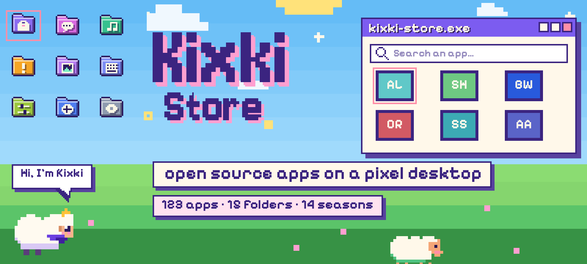

</div>

<p align="center">
  <b>An open source app store disguised as a desktop.</b><br>
  You open folders like windows, and a little sheep called Kixki follows you around the page, chats and gets into trouble.
</p>

<p align="center">
  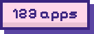
  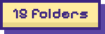
  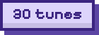
  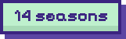
  
  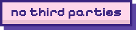
</p>

<p align="center">
  <a href="https://kitsukilove.github.io/KixKi-Store/"><b>▶ Open the store</b></a> &nbsp;·&nbsp;
  <a href="docs/DESARROLLO.md">Technical docs (Spanish)</a> &nbsp;·&nbsp;
  <a href="README.md">Español</a>
</p>

<p align="center">
  <a href="#what-it-has">What it has</a> &nbsp;·&nbsp;
  <a href="#folders">Folders</a> &nbsp;·&nbsp;
  <a href="#gallery">Gallery</a> &nbsp;·&nbsp;
  <a href="#get-started">Get started</a> &nbsp;·&nbsp;
  <a href="#add-an-app">Add an app</a> &nbsp;·&nbsp;
  <a href="#docs">Docs</a> &nbsp;·&nbsp;
  <a href="#credits">Credits</a>
</p>

<br>

<a id="what-it-has"></a>
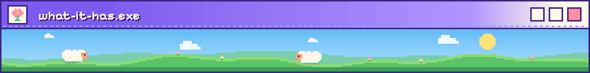

The collection is small and curated: **123 apps in 15 folders**, each with a description, links and warnings. What makes it different is the page itself:

<table>
<tr>
<td align="center" valign="top" width="33%">
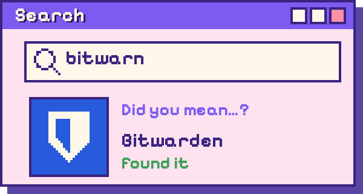<br>
<sub><b>Forgiving search</b><br>Accents, hyphens and typos don't matter. If nothing matches, it suggests “Did you mean…?”.</sub>
</td><td align="center" valign="top" width="33%">
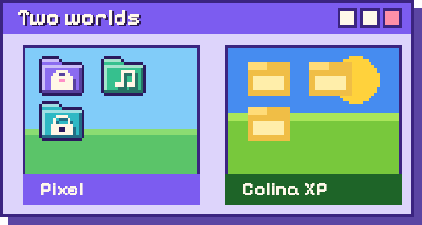<br>
<sub><b>Two worlds</b><br>Pixel and Colina XP (unlocked by beating cow.exe). Each world remembers its season.</sub>
</td><td align="center" valign="top" width="33%">
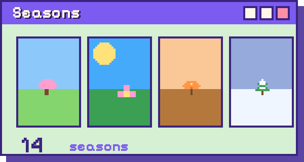<br>
<sub><b>14 seasons</b><br>Valley, Spring, Summer, Autumn, Winter, Halloween and Christmas in each world. “Auto” follows the real date. With rain, lightning and thunder.</sub>
</td>
</tr>
<tr>
<td align="center" valign="top" width="33%">
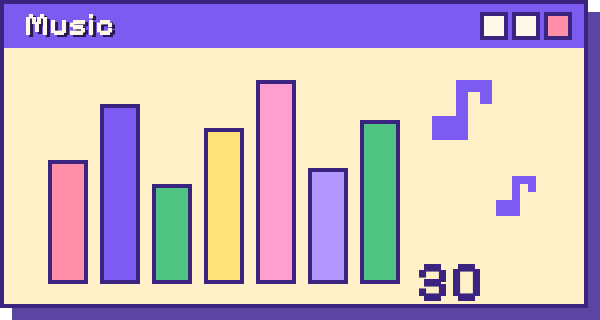<br>
<sub><b>30 music pieces</b><br>All original, and they change with the background, the season and day/night. They're synthesized in the browser: there are no audio files.</sub>
</td><td align="center" valign="top" width="33%">
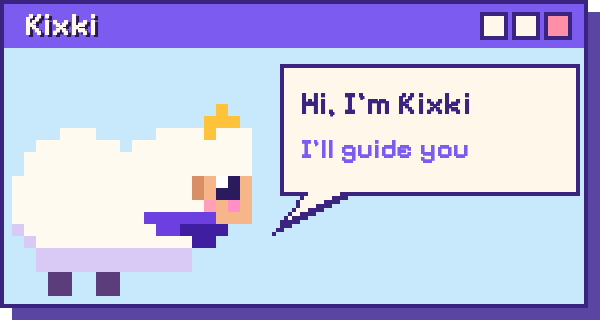<br>
<sub><b>Kixki, the guide sheep</b><br>She chats, plays pranks, lets you grab and throw her, gives tips and unlocks achievements. In Spanish and English.</sub>
</td><td align="center" valign="top" width="33%">
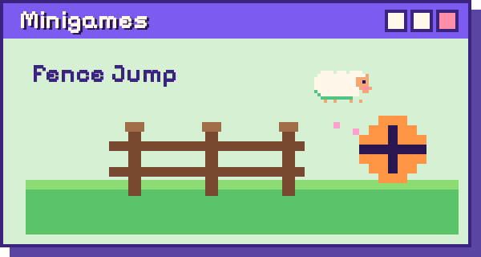<br>
<sub><b>Minigames</b><br>Fence Jump, a secret basketball court and several XP-mode games.</sub>
</td>
</tr>
<tr>
<td align="center" valign="top" width="33%">
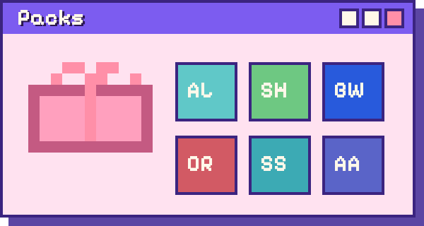<br>
<sub><b>Packs</b><br>6 lists to install several apps at once, with a step-by-step “Guide me”.</sub>
</td><td align="center" valign="top" width="33%">
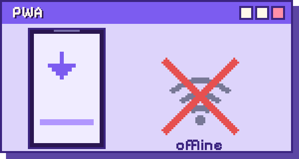<br>
<sub><b>PWA</b><br>Installs on your phone and works offline.</sub>
</td><td align="center" valign="top" width="33%">
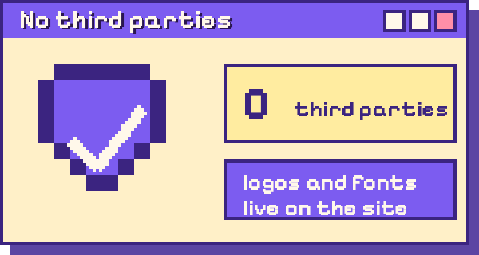<br>
<sub><b>No third parties</b><br>It contacts no one: logos, fonts and QR codes live on the site itself.</sub>
</td>
</tr>
</table>

<details>
<summary><b>Also…</b></summary>

- **Welcome questions:** Kixki asks how you describe yourself, your Android version and what you're into, then builds a “For you” list. You can skip them, and answers stay only in your browser.
- **Warnings on every app:** “Needs Android N+” and “Needs Shizuku, root or ADB”; one button hides the ones that don't work for you.
- **Sorting and filters:** original, A–Z, most stars or most recently updated.
- **Large text and high contrast** from the menu, and descriptions in English.
- **New apps:** give an app a date in `apps.json` and it shows as “New” for 12 days.

</details>

<p align="center">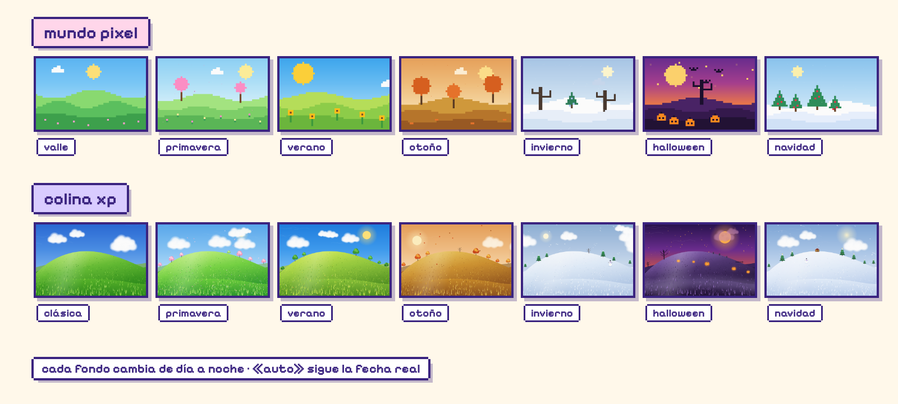</p>

The sheep button (top right) and the **Season** button in the menu change the season of whichever world you're in. The **Background** button switches worlds. Each world remembers its season.

<p align="center">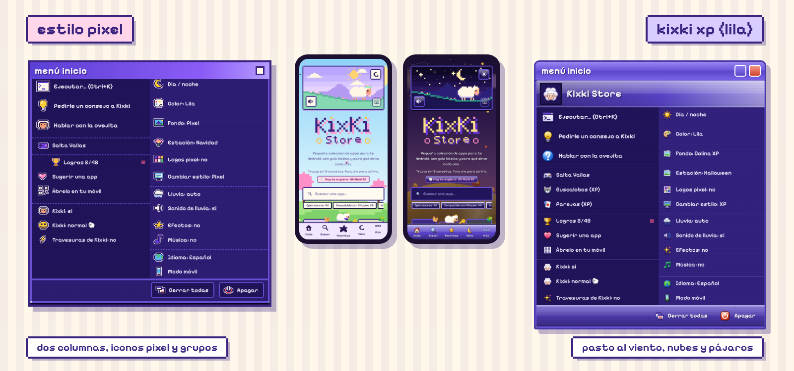</p>

<a id="folders"></a>
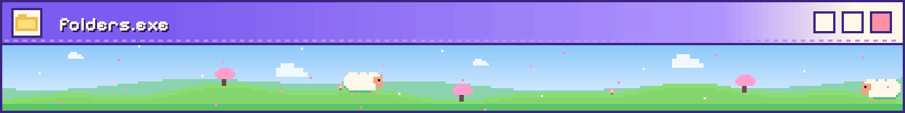

Each folder opens like a desktop window (and has its own button in the bottom bar). Tap one to see its apps.

<p align="center">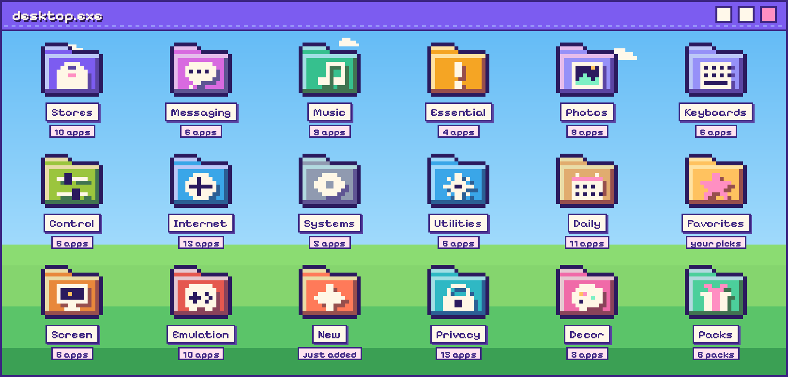</p>

<details>
<summary><b>What's in each folder</b></summary>

| Folder | What for | Apps |
|---|---|--:|
| 🧺 **Open-source stores** | To find, install and update apps | 10 |
| 🔑 **Essential!** | Makes other apps work better | 4 |
| 🧩 **App control** | Remove, limit and check what your apps do | 6 |
| 🛡️ **Utilities** | Automate, tweak and connect with your PC | 6 |
| 🔋 **Screen & battery** | Save battery and control your screen | 6 |
| 🔒 **Privacy** | Protect your data, your location and your links | 13 |
| 💬 **Messaging & email** | Encrypted chats and email without tracking | 6 |
| 🖼️ **Photos & files** | Edit, organize and store your files | 8 |
| 🌐 **Internet** | Browse, read, download and share online | 15 |
| 📅 **Daily** | Notes, tasks, calendar, AI and workouts | 11 |
| 🎮 **Emulation** | Play your classics and optimize your games | 10 |
| 🌈 **Decor** | Wallpapers and widgets for your screen | 8 |
| 🎧 **Music** | Play, download and create | 9 |
| ✍️ **Keyboards** | Type with more style and privacy | 6 |
| 💿 **Systems** | Operating systems for your PC or phone | 5 |

Plus: **Favorites** (the ones you save), **New** (just added) and **Packs** (6 guided lists).

</details>

<a id="gallery"></a>
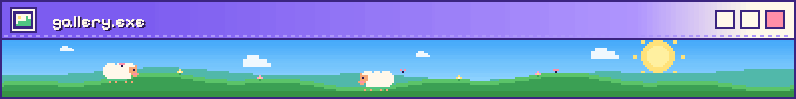

Real screenshots of the page. (The page itself is in Spanish with an English switch.)

<table>
<tr>
<td align="center" valign="top" width="50%">
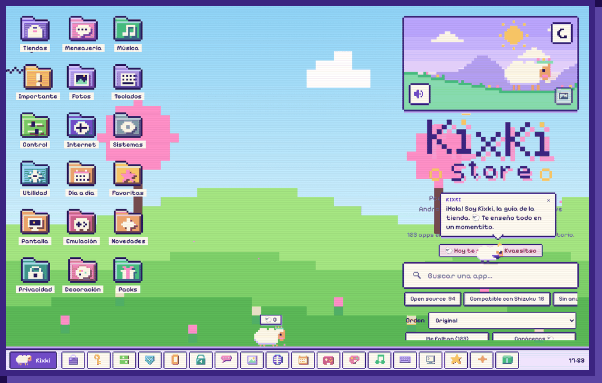<br>
<sub>Pixel world in spring: the desktop with its folders.</sub>
</td><td align="center" valign="top" width="50%">
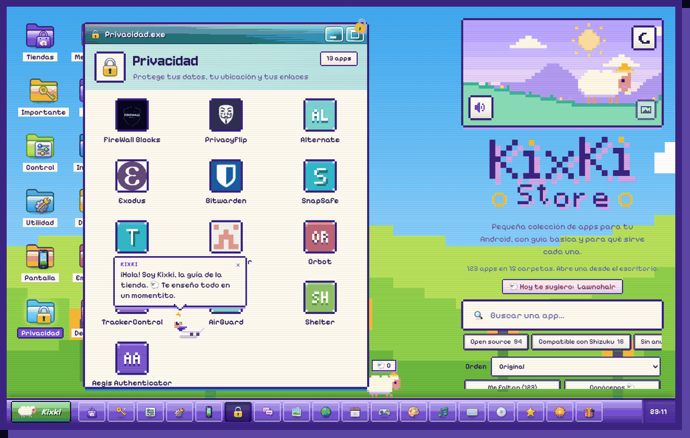<br>
<sub>Colina XP in summer, with the Privacy folder open.</sub>
</td>
</tr>
<tr>
<td align="center" valign="top" width="50%">
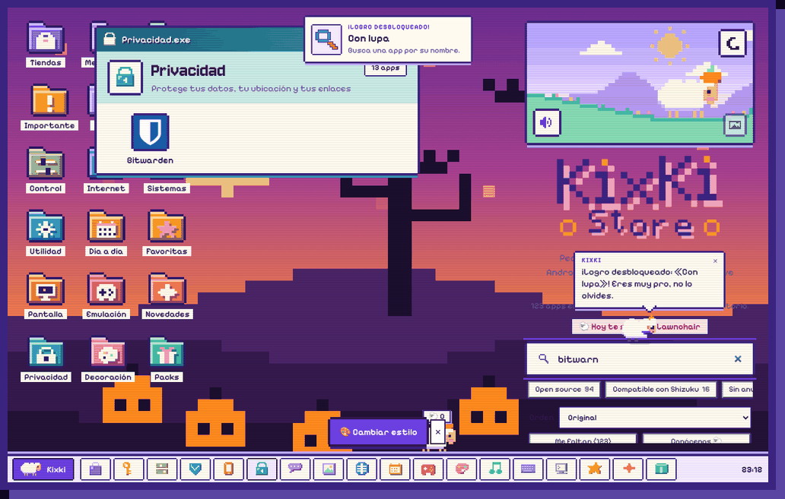<br>
<sub>Search forgives typos: “bitwarn” finds Bitwarden.</sub>
</td><td align="center" valign="top" width="50%">
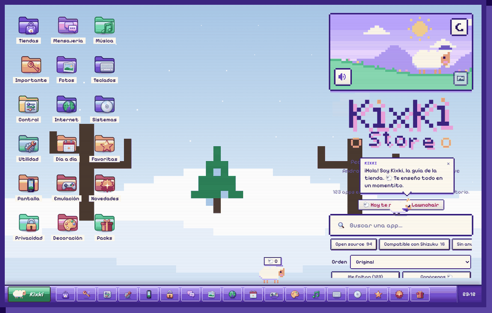<br>
<sub>Colina XP in winter.</sub>
</td>
</tr>
</table>

<p align="center">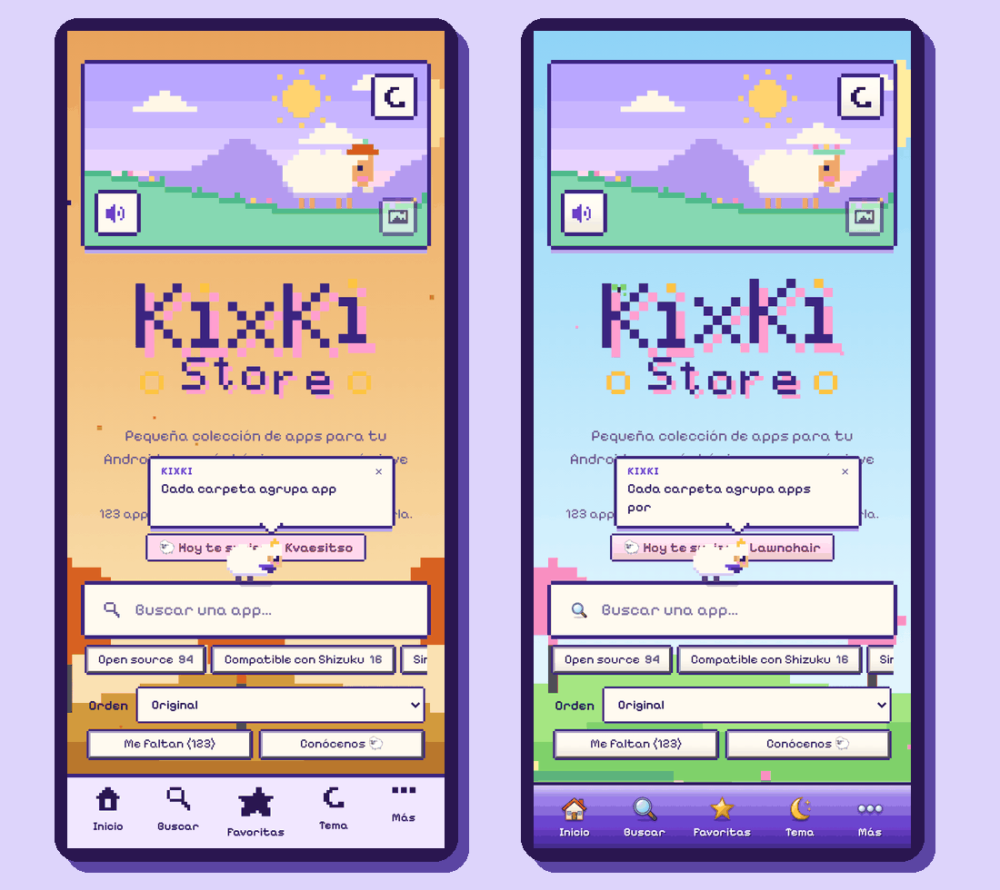<br><sub>On mobile, with a bottom bar: Pixel (left) and Colina XP (right).</sub></p>

<a id="get-started"></a>
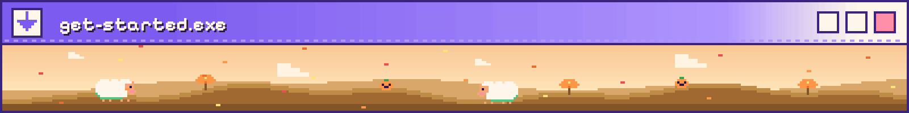

**Try it on your computer**

```bash
python3 -m http.server
# and open http://localhost:8000
```

**Publish it with GitHub Pages**

1. Upload the whole project to your repository, **in the root**. Don't move files into folders: the code's paths are flat.
2. In the repository: **Settings → Pages → Deploy from a branch → `main` / `(root)`**.
3. The site ends up at `https://YOUR-USER.github.io/KixKi-Store/`.

> **If you upload changes and still see the old version:** close and reopen the page. The PWA cache only refreshes when the `V` version in `sw.js` changes.

<a id="add-an-app"></a>
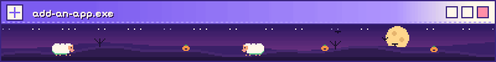

Open `apps.json`, copy an entry inside the `apps` of the category you want, and change its data:

```json
{
  "name": "Shizuku",
  "tag": "Almost like root",
  "desc": "Lets other apps use system features…",
  "links": [["Download", "https://github.com/thedjchi/Shizuku"], ["Tutorial", "https://youtu.be/…"]],
  "tip": "Heads up: optional warning shown on the app's card.",
  "added": "2026-10-13"
}
```

| Field | What it does |
|---|---|
| `name` · `tag` · `desc` | Name, short tagline and description. |
| `links` | A list of `["Text", "URL"]`. |
| `logo` | Optional. If you leave it out, it's fetched from the repository; or `"logo": ["https://…"]`. |
| `tip` | Optional: a warning inside the app's card. |
| `added` | Optional: with a date, the app shows as **“New”** for 12 days. |

- **Categories:** each one (`id`, `e` emoji, `t` title, `s` subtitle) becomes a window, a desktop folder and a bottom-bar button. To move an app, cut its entry and paste it into another category's `apps`.
- **Packs:** the “install several apps at once” lists are in `PACKS` at the end of `app.js`. If you add their English text to `i18n.js`, they get translated too.
- **English descriptions:** add the new app's entry to `data/en.json` (if it's missing, it shows in Spanish).
- **It updates itself:** when you upload `apps.json`, the “Sincronizar logos y datos” Action downloads logos, GitHub stars, fonts and QR codes into the site (and repeats daily). Another Action checks for broken links every Monday. Suggestions arrive through the *issues* template.

<a id="docs"></a>
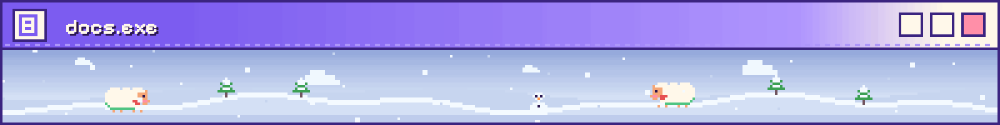

The technical side lives on separate pages so this README stays light. The deep docs are in Spanish:

- **[Structure](docs/DESARROLLO.md#estructura)** — which file does what, and what to do if you add one.
- **[Tests](docs/DESARROLLO.md#pruebas)** — the Playwright commands and console tricks.
- **[More details](docs/DESARROLLO.md#mas-detalles)** — the build log: store, Kixki, Fence Jump, rain, cow.exe, Colina XP…

<details>
<summary><b>Quick look: structure</b></summary>

Everything the page needs lives in the **root**. The images for the READMEs are in `docs/` (the page doesn't use them).

| Where | What it is |
|---|---|
| `index.html` · `manifest.webmanifest` · `sw.js` · icons and `logo.png` | the page, the PWA and its cache (`SHELL` in `sw.js` lists what gets stored) |
| `styles.css` · `pixel-ui.css` · `app.js` · `i18n.js` | the store, the pixel style (Start menu in columns) and language |
| `scenes.js` · `pxbg.css` · `pxbg.js` | backgrounds, seasons and the little critters of the pixel backgrounds |
| `music.js` | original music (30 pieces, Web Audio) |
| `lluvia.*` · `xpbg.*` | rain and its sound · Colina XP (grass, sky, birds) |
| `eggs.js` · `vallas.js` | easter eggs and Fence Jump |
| `kixki*.js/css`, `dialogs.js`, `basket.*`, `consejos.*` | Kixki, the guide sheep |
| `vacaboss.*`, `vaca.gif`, `vaca-jefa.*` | cow.exe rebels |
| `xpmode.js` + `xp.css`, `xp-icons.css`, `xp-games.*` | XP mode (“Change style”) |
| `apps.json` · `data/` · `logos/` · `fonts/` · `vendor/` | the catalog and the resources the Action downloads |
| `tools/` | tests and utilities; `pixel-fuente/` and `xp-fuente/` generate `pixel-ui.css` and `xp.css` |
| `.github/` | suggestions template and Actions (`sync.yml`, `links.yml`) |

> **If you add a new file**, add it to `SHELL` in `sw.js` and bump the cache version (`V`).

</details>

<details>
<summary><b>Quick look: tests</b></summary>

They run with headless Chromium: `npm i -D playwright`, then add `movil` at the end for the mobile view.

| Command | What it checks |
|---|---|
| `node tools/test-fondos.mjs` | the Background / Season picker and its memory |
| `node tools/test-buscador.mjs` | the forgiving search and the season button |
| `node tools/test-pixel-musica.mjs` | pixel menu, living backgrounds and the 30 music pieces |
| `node tools/test-xpbg.mjs` | Colina XP, rain, pause and the XP menu |
| `node tools/test-vaca.mjs` | cow.exe, combat and the reward/punishment backgrounds |
| `node tools/test-tienda.mjs` | welcome, “For you”, sorting, filters, “I already have it”, per-app link and accessibility |
| `node tools/test-extras.mjs` | English, text size/contrast, guided packs and Optimization |
| `node tools/test-inicio.mjs` | start screen without folders or silence, pixel/fallback logos, Kixki's bubble |
| `node tools/test-dialogos.mjs` | the dialogs and Kixki's latency |
| `node tools/check-dialogs.mjs` · `check-links.mjs` | valid texts (es + en) · broken links |

Console tricks: `KXT.open()` (opens the welcome questions) · `KXT.reset()` (forgets your answers) · `KXB.next()` · `KXB.setWorld("pixel"|"xp")` · `KXB.season("otono")` · `KXRAIN.lightning()` · `KXQ.list()` · `KXK.say("hola")` · `KXM.toggle()`.

</details>

[**Read the full technical docs (Spanish)**](docs/DESARROLLO.md)

<a id="credits"></a>
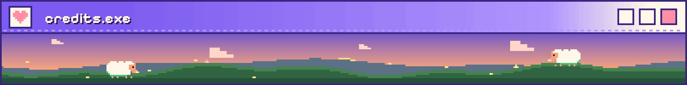

Made with love by **KitsukiLove**. The apps, their logos and their names belong to their respective authors: the store only links to them and explains them.

<p align="center">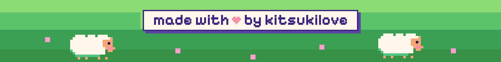</p>
