<div align="center">

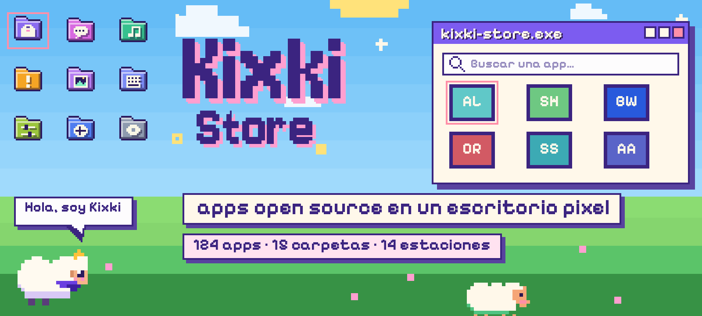

</div>

<p align="center">
  <b>Una tienda de apps open source que se disfraza de escritorio.</b><br>
  Abres carpetas como ventanas, y una ovejita llamada Kixki te sigue por la página, charla y se mete en líos.
</p>

<p align="center">
  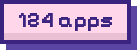
  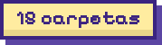
  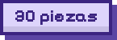
  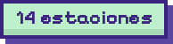
  
  
</p>

<p align="center">
  <a href="https://kitsukilove.github.io/KixKi-Store/"><b>▶ Abrir la tienda</b></a> &nbsp;·&nbsp;
  <a href="docs/DESARROLLO.md">Documentación técnica</a> &nbsp;·&nbsp;
  <a href="README.en.md">English</a>
</p>

<p align="center">
  <a href="#que-trae">Qué trae</a> &nbsp;·&nbsp;
  <a href="#carpetas">Carpetas</a> &nbsp;·&nbsp;
  <a href="#galeria">Galería</a> &nbsp;·&nbsp;
  <a href="#empezar">Empezar</a> &nbsp;·&nbsp;
  <a href="#anadir">Añadir una app</a> &nbsp;·&nbsp;
  <a href="#docs">Documentación</a> &nbsp;·&nbsp;
  <a href="#creditos">Créditos</a>
</p>

<br>

<a id="que-trae"></a>
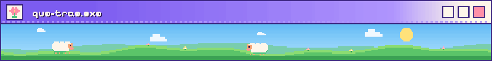

La colección es pequeña y cuidada: **124 apps en 15 carpetas**, cada una con su descripción, enlaces y avisos. Lo que la hace distinta es la página:

<table>
<tr>
<td align="center" valign="top" width="33%">
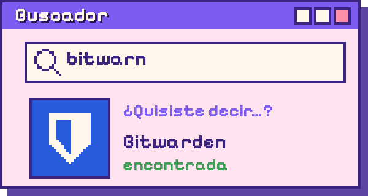<br>
<sub><b>Buscador que perdona</b><br>Acentos, guiones y letras mal puestas no importan. Si no encuentra nada, sugiere «¿Quisiste decir…?».</sub>
</td><td align="center" valign="top" width="33%">
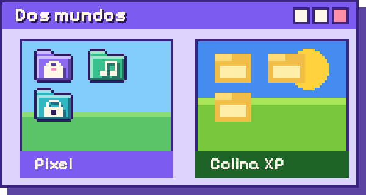<br>
<sub><b>Dos mundos</b><br>Pixel y Colina XP (se gana venciendo a vaca.exe). Cada mundo recuerda su estación.</sub>
</td><td align="center" valign="top" width="33%">
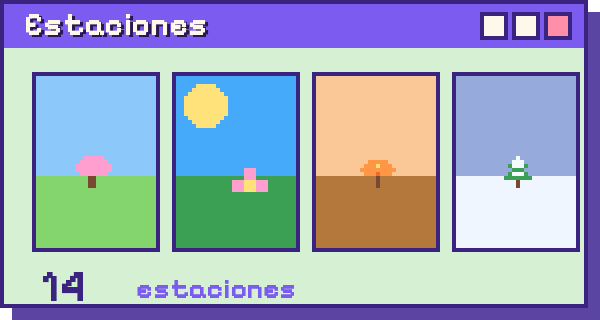<br>
<sub><b>14 estaciones</b><br>Valle, Primavera, Verano, Otoño, Invierno, Halloween y Navidad en cada mundo. «Auto» sigue la fecha real. Con lluvia, relámpagos y trueno.</sub>
</td>
</tr>
<tr>
<td align="center" valign="top" width="33%">
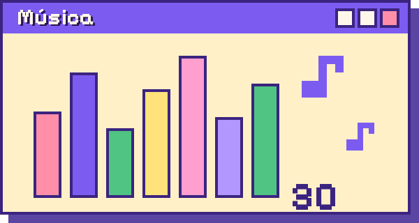<br>
<sub><b>30 piezas de música</b><br>Originales, y cambian con el fondo, la estación y el día/noche. Se generan en el navegador: no hay archivos de audio.</sub>
</td><td align="center" valign="top" width="33%">
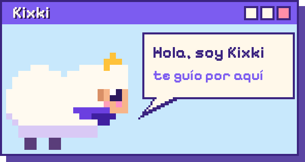<br>
<sub><b>Kixki, la oveja guía</b><br>Charla, hace travesuras, se deja agarrar y lanzar, da consejos y desbloquea logros. En español e inglés.</sub>
</td><td align="center" valign="top" width="33%">
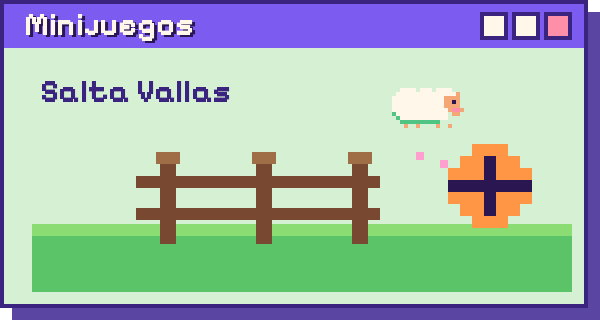<br>
<sub><b>Minijuegos</b><br>Salta Vallas, una cancha secreta de básquet y varios juegos del modo XP.</sub>
</td>
</tr>
<tr>
<td align="center" valign="top" width="33%">
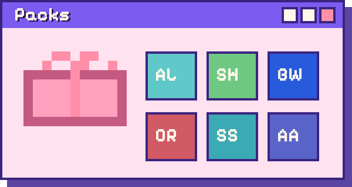<br>
<sub><b>Packs</b><br>6 listas para instalar varias apps de una vez, con «Guíame» paso a paso.</sub>
</td><td align="center" valign="top" width="33%">
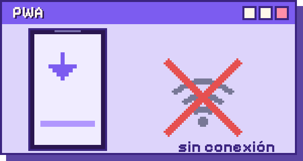<br>
<sub><b>PWA</b><br>Se instala en tu celular y funciona sin conexión.</sub>
</td><td align="center" valign="top" width="33%">
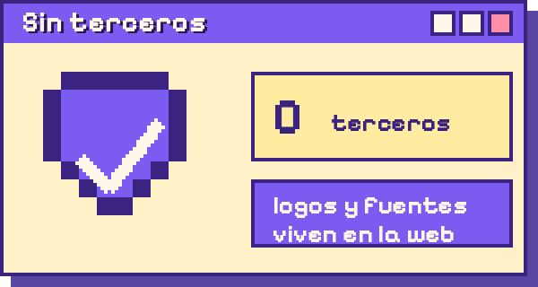<br>
<sub><b>Sin terceros</b><br>No contacta con nadie: logos, fuentes y QR viven en la propia web.</sub>
</td>
</tr>
</table>

<details>
<summary><b>Y también…</b></summary>

- **Preguntas de bienvenida:** Kixki te pregunta cómo te describes, tu versión de Android y qué te interesa, y arma una lista «Para ti». Se pueden saltar y se guardan solo en tu navegador.
- **Avisos en cada app:** «Pide Android N+» y «Necesita Shizuku, root o ADB»; un botón oculta las que no te sirven.
- **Orden y filtros:** original, A–Z, más estrellas o más actualizadas.
- **Letra grande y alto contraste** desde el menú, y descripciones en inglés.
- **Apps nuevas:** con una fecha en `apps.json`, la app sale como «Nueva» durante 12 días.

</details>

<p align="center">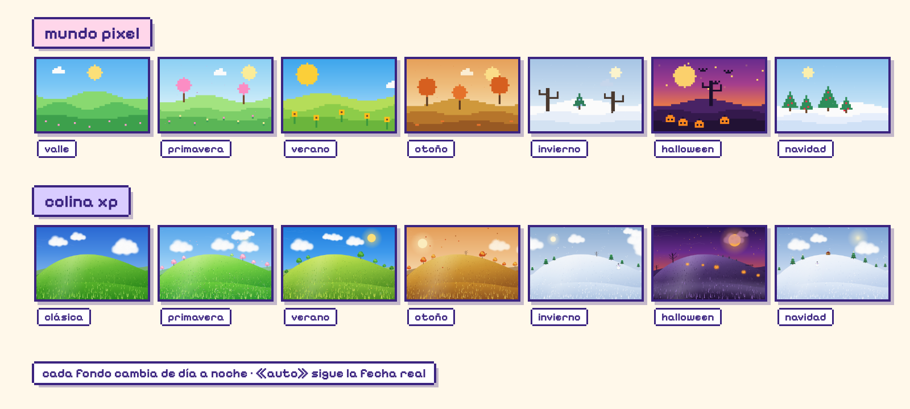</p>

El botón de la ovejita (arriba a la derecha) y el botón **Estación** del menú cambian la estación del mundo en que estés. El botón **Fondo** cambia de mundo. Cada mundo recuerda su estación.

<p align="center">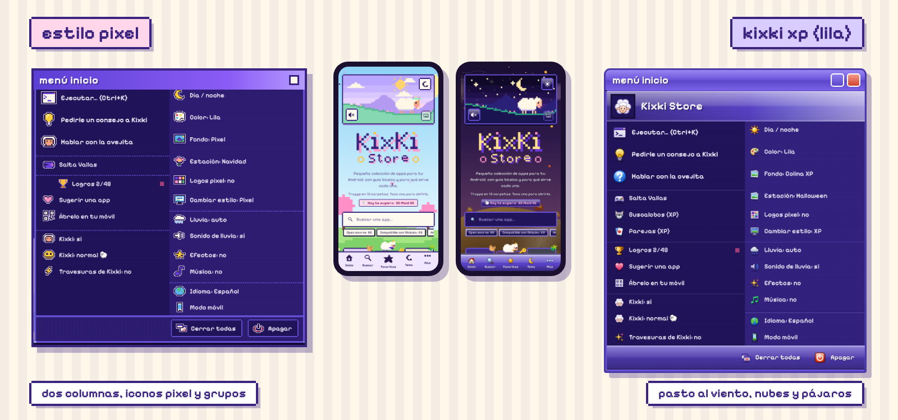</p>

<a id="carpetas"></a>
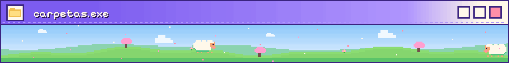

Cada carpeta se abre como una ventana del escritorio (y tiene su botón en la barra de abajo). Toca una para ver sus apps.

<p align="center">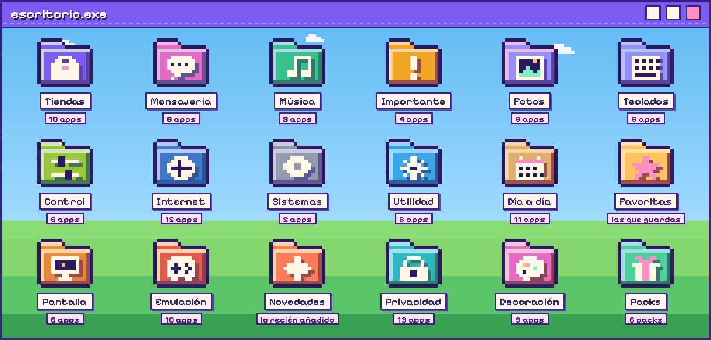</p>

<details>
<summary><b>Qué hay en cada carpeta</b></summary>

| Carpeta | Para qué | Apps |
|---|---|--:|
| 🧺 **Tiendas open source** | Para encontrar, instalar y actualizar apps | 10 |
| 🔑 **¡Importante!** | Hace que otras apps funcionen mejor | 4 |
| 🧩 **Control de apps** | Quita, limita y revisa lo que hacen tus apps | 6 |
| 🛡️ **Utilidad** | Automatiza, ajusta y conecta con tu PC | 6 |
| 🔋 **Pantalla y batería** | Ahorra batería y controla tu pantalla | 6 |
| 🔒 **Privacidad** | Protege tus datos, tu ubicación y tus enlaces | 13 |
| 💬 **Mensajería y correo** | Chats y correo con cifrado y sin rastreo | 6 |
| 🖼️ **Fotos y archivos** | Edita, organiza y guarda tus archivos | 8 |
| 🌐 **Internet** | Navega, lee, descarga y comparte por la red | 15 |
| 📅 **Día a día** | Notas, tareas, calendario, IA y entrenamientos | 11 |
| 🎮 **Emulación** | Juega tus clásicos y optimiza tus juegos | 10 |
| 🌈 **Decoración** | Fondos y widgets para tu pantalla | 9 |
| 🎧 **Música** | Reproducir, descargar y crear | 9 |
| ✍️ **Teclados** | Escribe con más estilo y más privacidad | 6 |
| 💿 **Sistemas** | Sistemas operativos para tu PC o tu móvil | 5 |

Además: **Favoritas** (las que guardas), **Novedades** (lo recién añadido) y **Packs** (6 listas guiadas).

</details>

<a id="galeria"></a>
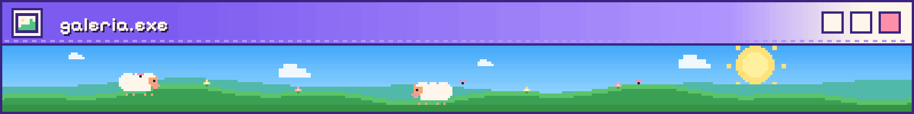

Capturas reales de la página.

<table>
<tr>
<td align="center" valign="top" width="50%">
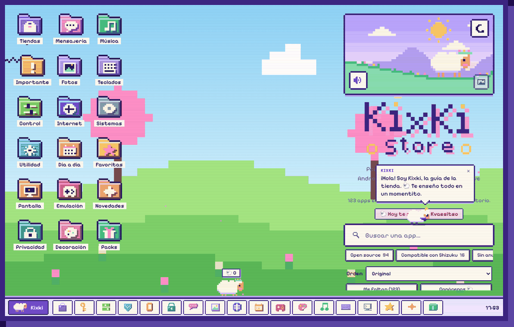<br>
<sub>Mundo Pixel en primavera: el escritorio con sus carpetas.</sub>
</td><td align="center" valign="top" width="50%">
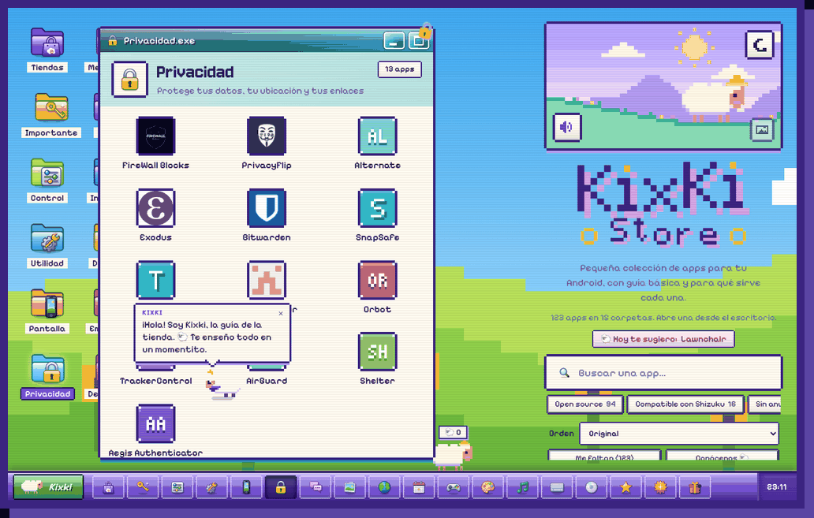<br>
<sub>Colina XP en verano, con la carpeta Privacidad abierta.</sub>
</td>
</tr>
<tr>
<td align="center" valign="top" width="50%">
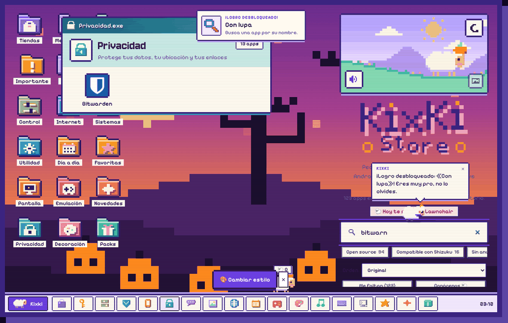<br>
<sub>El buscador perdona errores: «bitwarn» encuentra Bitwarden.</sub>
</td><td align="center" valign="top" width="50%">
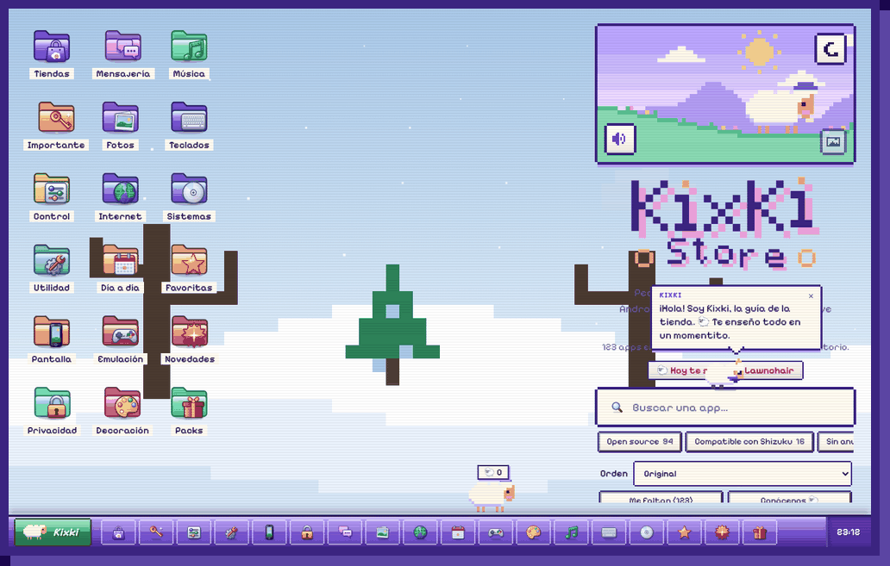<br>
<sub>Colina XP en invierno.</sub>
</td>
</tr>
</table>

<p align="center">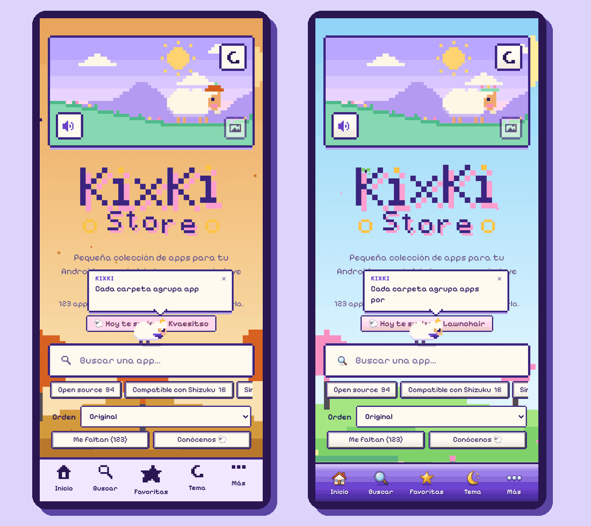<br><sub>En el móvil, con barra inferior: Pixel (izquierda) y Colina XP (derecha).</sub></p>

<a id="empezar"></a>
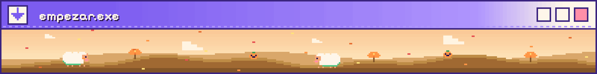

**Probarla en tu computadora**

```bash
python3 -m http.server
# y abre http://localhost:8000
```

**Publicarla con GitHub Pages**

1. Sube todo el proyecto a tu repositorio, **en la raíz**. No muevas los archivos a carpetas: las rutas del código son planas.
2. En el repositorio: **Settings → Pages → Deploy from a branch → `main` / `(root)`**.
3. La web queda en `https://TU-USUARIO.github.io/KixKi-Store/`.

> **Si subes cambios y ves lo viejo:** cierra y abre la página. El caché de la PWA se renueva solo cuando cambia la versión `V` de `sw.js`.

<a id="anadir"></a>
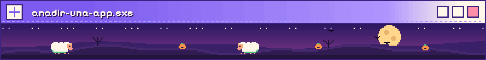

Abre `apps.json`, copia una entrada dentro de `apps` de la categoría que quieras y cambia sus datos:

```json
{
  "name": "Shizuku",
  "tag": "Casi como root",
  "desc": "Permite que otras apps usen funciones del sistema…",
  "links": [["Descarga", "https://github.com/thedjchi/Shizuku"], ["Tutorial", "https://youtu.be/…"]],
  "tip": "Ojo: aviso opcional que se muestra en la ficha.",
  "added": "2026-10-13"
}
```

| Campo | Para qué sirve |
|---|---|
| `name` · `tag` · `desc` | Nombre, frase corta y descripción. |
| `links` | Lista de `["Texto", "URL"]`. |
| `logo` | Opcional. Si no lo pones se busca solo en el repositorio; o `"logo": ["https://…"]`. |
| `tip` | Opcional: un aviso dentro de la ficha. |
| `added` | Opcional: con una fecha, la app sale como **«Nueva»** durante 12 días. |

- **Categorías:** cada una (`id`, `e` emoji, `t` título, `s` subtítulo) sale como ventana, carpeta del escritorio y botón de la barra. Para mover una app, corta su entrada y pégala en `apps` de otra categoría.
- **Packs:** las listas de «instalar varias apps de una vez» están en `PACKS` al final de `app.js`. Si añades su texto en inglés a `i18n.js`, también se traduce.
- **Descripciones en inglés:** añade la entrada de la app nueva en `data/en.json` (si falta, se ve en español).
- **Se actualiza solo:** al subir `apps.json`, la Action «Sincronizar logos y datos» descarga logos, estrellas de GitHub, fuentes y QR a la propia web (y se repite cada día). Otra Action revisa enlaces rotos cada lunes. Las sugerencias llegan por la plantilla de *issues*.

<a id="docs"></a>
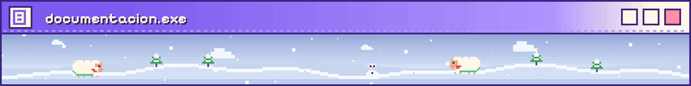

Lo técnico vive en una página aparte para que este README se quede ligero:

- **[Estructura](docs/DESARROLLO.md#estructura)** — qué archivo hace qué, y qué hacer si añades uno nuevo.
- **[Pruebas](docs/DESARROLLO.md#pruebas)** — los comandos de Playwright y los trucos de consola.
- **[Más detalles](docs/DESARROLLO.md#mas-detalles)** — el diario de lo construido: tienda, Kixki, Salta Vallas, lluvia, vaca.exe, Colina XP…

<a id="creditos"></a>
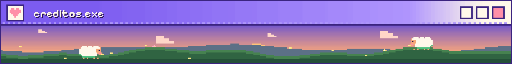

Hecho con cariño por **KitsukiLove**. Las apps, sus logos y sus nombres son de sus respectivos autores: la tienda solo las enlaza y las explica.

<p align="center">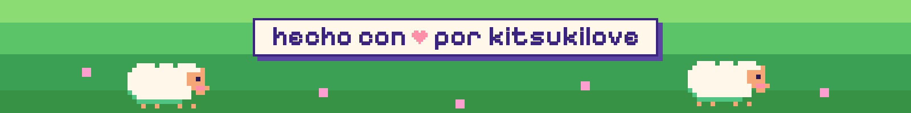</p>
