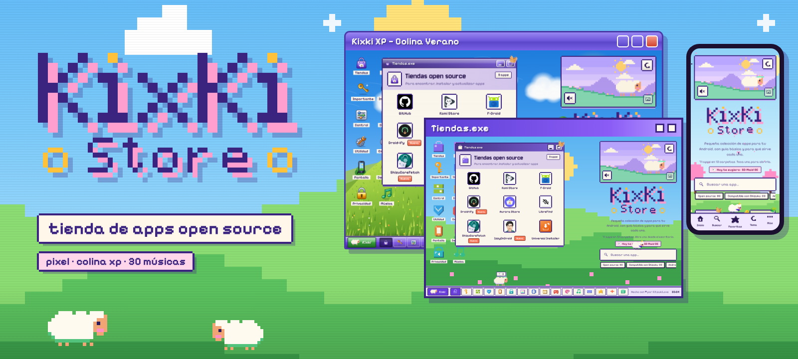
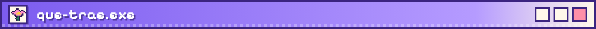
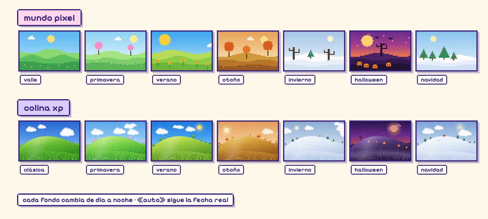
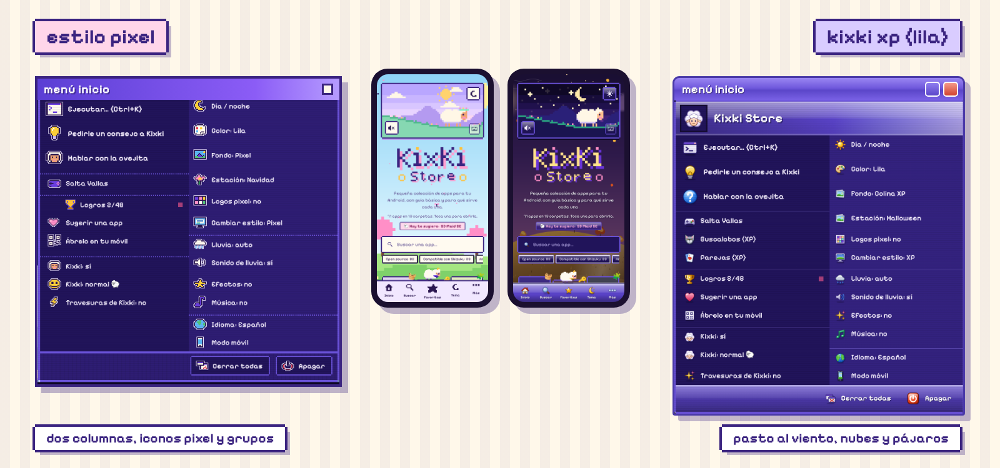
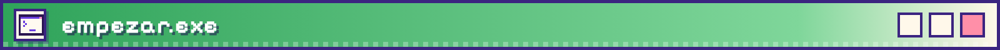
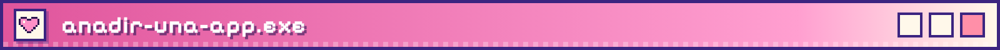
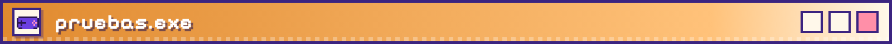
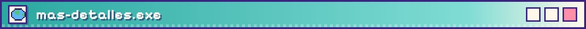
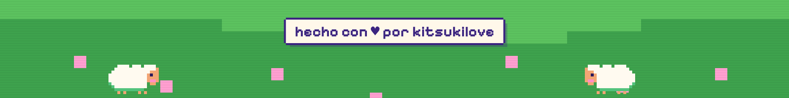

<div align="center">



</div>

<p align="center">
  <b>Una tienda de apps open source que se disfraza de escritorio.</b><br>
  Abres carpetas como ventanas, y una ovejita llamada Kixki te sigue por la página, charla y se mete en líos.
</p>

<p align="center">
  <a href="#que-trae">Qué trae</a> &nbsp;·&nbsp;
  <a href="#empezar">Empezar</a> &nbsp;·&nbsp;
  <a href="#anadir-una-app">Añadir una app</a> &nbsp;·&nbsp;
  <a href="#estructura">Estructura</a> &nbsp;·&nbsp;
  <a href="#pruebas">Pruebas</a> &nbsp;·&nbsp;
  <a href="#mas-detalles">Más detalles</a>
</p>

<br>

<a id="que-trae"></a>


La colección es pequeña y cuidada: **121 apps en 15 carpetas**, cada una con su descripción, enlaces y avisos, un **buscador que perdona errores** (acentos, guiones y letras mal puestas; si no encuentra nada, sugiere «¿Quisiste decir…?») y «packs» para instalar varias de una vez. Lo que la hace distinta es la página:

- **Dos mundos, Pixel y Colina XP,** y en cada uno Valle, Primavera, Verano, Otoño, Invierno, Halloween y Navidad. «Auto» sigue la fecha real.
- **Lluvia con relámpagos y trueno,** y sonido de lluvia sintetizado.
- **30 piezas de música original** que cambian con el fondo, la estación y el día/noche. No hay archivos de audio: se genera todo en el navegador.
- **Kixki,** la oveja guía: charla, hace travesuras, se deja agarrar y lanzar, da consejos y desbloquea logros. Español e inglés.
- **Minijuegos:** Salta Vallas, una cancha secreta de básquet y varios juegos del modo XP.
- **PWA:** se instala, funciona sin conexión y no contacta con terceros (logos, fuentes y QR viven en la propia web).

<p align="center"></p>

El botón de la imagen de la ovejita (arriba a la derecha) y el botón **Estación** del menú cambian la estación del mundo en que estés. El botón **Fondo** del menú cambia de mundo (la Colina XP se gana venciendo a vaca.exe). Cada mundo recuerda su estación.

<p align="center"></p>

<a id="empezar"></a>


**Probarla en tu computadora**

```bash
python3 -m http.server
# y abre http://localhost:8000
```

**Publicarla con GitHub Pages**

1. Sube todo el proyecto a tu repositorio, **en la raíz**. No muevas los archivos a carpetas: las rutas del código son planas.
2. En el repositorio: **Settings → Pages → Deploy from a branch → `main` / `(root)`**.
3. La web queda en `https://TU-USUARIO.github.io/KixKi-Store/`.

> **Si subes cambios y ves lo viejo:** cierra y abre la página. El caché de la PWA se renueva solo cuando cambia la versión `V` de `sw.js`.

<a id="anadir-una-app"></a>


Abre `apps.json`, copia una entrada dentro de `apps` de la categoría que quieras y cambia sus datos:

```json
{
  "name": "Shizuku",
  "tag": "Casi como root",
  "desc": "Permite que otras apps usen funciones del sistema…",
  "links": [["Descarga", "https://github.com/thedjchi/Shizuku"], ["Tutorial", "https://youtu.be/…"]],
  "tip": "Ojo: aviso opcional que se muestra en la ficha.",
  "added": "2026-10-13"
}
```

| Campo | Para qué sirve |
|---|---|
| `name` · `tag` · `desc` | Nombre, frase corta y descripción. |
| `links` | Lista de `["Texto", "URL"]`. |
| `logo` | Opcional. Si no lo pones se busca solo en el repositorio; o `"logo": ["https://…"]`. |
| `tip` | Opcional: un aviso dentro de la ficha. |
| `added` | Opcional: con una fecha, la app sale como **«Nueva»** durante 12 días. |

- **Categorías:** cada una (`id`, `e` emoji, `t` título, `s` subtítulo) sale como ventana, carpeta del escritorio y botón de la barra. Para mover una app, corta su entrada y pégala en `apps` de otra categoría.
- **Packs:** las listas de «instalar varias apps de una vez» están en `PACKS` al final de `app.js`. Si añades su texto en inglés a `i18n.js`, también se traduce.
- **Se actualiza solo:** al subir `apps.json`, la Action «Sincronizar logos y datos» descarga logos, estrellas de GitHub, fuentes y QR a la propia web (y se repite cada día). Otra Action revisa enlaces rotos cada lunes. Las sugerencias llegan por la plantilla de *issues*.

<a id="estructura"></a>


Todo lo que la página necesita vive en la **raíz**. Las imágenes de este README están en `docs/` (la página no las usa).

| Dónde | Qué es |
|---|---|
| `index.html` · `manifest.webmanifest` · `sw.js` · iconos y `logo.png` | la página, la PWA y su caché (`SHELL` de `sw.js` lista lo que se guarda) |
| `styles.css` · `pixel-ui.css` · `app.js` · `i18n.js` | tienda, estilo pixel (menú Inicio en columnas) e idioma |
| `scenes.js` · `pxbg.css` · `pxbg.js` | fondos, estaciones y los bichitos de los fondos pixel |
| `music.js` | música original (30 piezas, Web Audio) |
| `lluvia.*` · `xpbg.*` | lluvia y su sonido · Colina XP (pasto, cielo, pájaros) |
| `eggs.js` · `vallas.js` | easter eggs y Salta Vallas |
| `kixki*.js/css`, `dialogs.js`, `basket.*`, `consejos.*` | Kixki, la oveja guía |
| `vacaboss.*`, `vaca.gif`, `vaca-jefa.*` | vaca.exe se rebela |
| `xpmode.js` + `xp.css`, `xp-icons.css`, `xp-games.*` | modo XP («Cambiar estilo») |
| `apps.json` · `data/` · `logos/` · `fonts/` · `vendor/` | catálogo y recursos que descarga la Action |
| `tools/` | pruebas y utilidades; `pixel-fuente/` y `xp-fuente/` generan `pixel-ui.css` y `xp.css` |
| `.github/` | plantilla de sugerencias y Actions (`sync.yml`, `links.yml`) |

> **Si añades un archivo nuevo**, súmalo a `SHELL` en `sw.js` y sube la versión de caché (`V`).

<a id="pruebas"></a>


Se hacen con Chromium sin pantalla: `npm i -D playwright` y luego, con `movil` al final para la vista de móvil:

| Comando | Qué comprueba |
|---|---|
| `node tools/test-fondos.mjs` | el selector Fondo / Estación y su memoria |
| `node tools/test-buscador.mjs` | el buscador tolerante y el botón de estación |
| `node tools/test-pixel-musica.mjs` | menú pixel, fondos con vida y las 30 piezas de música |
| `node tools/test-xpbg.mjs` | Colina XP, lluvia, pausa y menú XP |
| `node tools/test-vaca.mjs` | vaca.exe, combate y fondos de premio/castigo |
| `node tools/test-tienda.mjs` | bienvenida, «Para ti», orden, filtros, «Ya la tengo», enlace por app y accesibilidad |
| `node tools/test-dialogos.mjs` | los diálogos y la latencia de Kixki |
| `node tools/check-dialogs.mjs` · `check-links.mjs` | textos válidos (es + en) · enlaces rotos |

Trucos de consola: `KXT.open()` (abre las preguntas de bienvenida) · `KXT.reset()` (olvida tus respuestas) · `KXB.next()` · `KXB.setWorld("pixel"|"xp")` · `KXB.season("otono")` · `KXRAIN.lightning()` · `KXQ.list()` · `KXK.say("hola")` · `KXM.toggle()`.

<a id="mas-detalles"></a>


Todo lo que se fue construyendo, parte por parte. Abre una sección para leerla.

<details>
<summary><b>Tienda: bienvenida, «Para ti», orden y accesibilidad (tienda.js)</b></summary>

- **Preguntas de bienvenida** (la primera vez, o desde el menú → «Mi perfil…»): cómo te describes, si tienes root/Shizuku/ADB, tu versión de Android y qué te interesa. Se puede **saltar**. Se guardan solo en tu navegador (`kixki-perfil`).
- **«Para ti»**: hasta 6 apps según tus respuestas (nunca las que tu Android no soporta ni las que necesitan Shizuku/root si no lo tienes). Si empiezas, también te lleva al pack «Para empezar».
- **Avisos en cada app**: «Pide Android N+» (la atenúa) y «Necesita Shizuku, root o ADB». Los datos salen de los campos `min` y `priv` de `apps.json`. El botón **«Solo las que puedo usar»** oculta las que no te sirven.
- **Orden**: Original, A–Z, Más estrellas, Más actualizadas (usa `data/meta.json`).
- **«Ya la tengo»** en cada app, y el filtro **«Me faltan (N)»**.
- **«🔗 Enlace»**: copia un enlace que abre la tienda directo en esa app (`…/#app=Bitwarden`).
- **Accesibilidad**: cada ☆ tiene el nombre de su app, las ventanas «Ejecutar», juego y QR son diálogos (el foco no se escapa y vuelve a su sitio al cerrar), los lectores de pantalla oyen «N apps encontradas» o «Sin resultados».
- Los navegadores de prueba no ven la bienvenida salvo con `?bienvenida=1`.

### Rendimiento (batería)
- El parpadeo de las ovejas pasó de una animación CSS infinita a un temporizador: en reposo la página gasta **~4 % de CPU en vez de ~20 %** (en invierno, de 38 % a 5 %). Las estrellas titilan en 6 grupos y se pausan cuando no se ven.
- Logos reducidos (de 3.5 MB a 0.6 MB) y `logo.png` de 1 MB a 100 KB.
- El service worker pide los archivos nuevos saltándose la caché del navegador, para no guardar versiones viejas.

### Arreglos
- Datos guardados dañados (favoritas, vistas, logros) ya no impiden que la página arranque.
- 11 logos que faltaban (daban 404) ahora son iconos pixel propios (`logos/*.svg`).

</details>

<details>
<summary><b>Kixki, la oveja guía</b></summary>

- `kixki.js` + `kixki.css` (parte 1): Kixki pasea por la barra de búsqueda y las carpetas, habla y reacciona.
- `kixki2.js` + `kixki2.css` (parte 2): **logros** (menú Kixki / Más → «Logros»), y en PC Kixki baja a charlar con la ovejita que camina abajo.
- `kixki3.js` + `kixki3.css` (parte 3): **personalidad pícara, travesuras y físicas**.
  - **Se puede agarrar:** arrastra a Kixki con el ratón o el dedo, por toda la página. Al soltarla cae, rebota y aterriza en la barra de búsqueda, en una ventana, en las filas de carpetas (móvil) o en el suelo. Si la lanzas, lo comenta.
  - **Ventanas:** si está encima de una ventana y la mueves, la cierras o la minimizas, se cae y se enfada (💢) unos segundos.
  - **Travesuras al azar** (menú → «Travesuras de Kixki: sí/no»): cambia el fondo si llevas ~6-10 min con el mismo (no lo hace con «Auto») y, en PC, «cierra» una ventana al azar (a veces estando ella encima).
  - **Charla:** chismes, teorías conspirativas de la tienda, comentarios «del código» y el plan secreto «Lana Total» (sube un % cada vez que lo menciona y se guarda entre visitas). Todo está en el objeto `TX` al principio de `kixki3.js`: añade o cambia frases ahí, en `[español, English]`.
  - En la consola: `KXK3.bg()`, `KXK3.close()`, `KXK3.scene("gossip"|"conspi"|"code"|"plan"|"sass")`, `KXK3.plan(50)`, `KXK3.state`.
- `basket.js` + `basket.css` (parte 4): **cancha secreta de básquet**.
  - `kixki3.js` cuenta los lanzamientos de verdad (soltarla con impulso) y avisa con el evento `throw`. A los **10** aparece una pestañita pegada al borde derecho de la pantalla (queda guardada en `kixki-bk`).
  - Al tocarla se abre `basquet.exe`: arrastra a Kixki hacia atrás y suéltala (resortera, con guía de puntos). Lejos del aro valen 3 puntos, cerca 2, y +1 si no toca el aro. Kixki está enfadada con quien la lanza: sus frases están en `dialogs.js` (`KXD.TX.bk*`, ver etapa 4b).
  - Logros nuevos: «Oveja voladora», «¡Canasta!» y «Estrella de la NBA (ovina)». En la consola: `KXBK.unlock()`, `KXBK.open()`, `KXBK.state`.
- **Gestor de diálogos** (en `kixki.js`, sección «gestor de diálogos»): todas las frases pasan por `KXK.say(mensaje, opciones)`.
  - Opciones: `p` (prioridad 1-3), `cat`, `key` + `cd` (enfriamiento), `ttl`, `replace`, `instant`, `ctx`, `mood`, `hl`, `vars`, `onStart`. Devuelve una promesa: `true` si se dijo entera, `false` si se descartó o la cortaron.
  - Categorías: **`ev`** eventos físicos (agarrar, lanzar, caer, ventana): reemplazan al globo actual en vez de esperar, salen de golpe y caducan a los 600 ms si no pueden salir · **`sp`** charla espontánea: tiene presupuesto por minuto (`KXK.budget(n, pausaMs)`, por defecto 5 y 15 s) · `amb` (p1) y `ui` (p2-p3): reacciones normales, con cola de 4 y caducidad de 12 s.
  - El **enfriamiento solo se gasta si la frase se dice de verdad**. `KXK.interrupt()` corta el globo y vacía la cola (`interrupt("ev")` solo la de ese contexto).
  - **Lanzar** usa la misma condición que el contador de la cancha (`THROW_V`, 850 px/s, en `kixki3.js`): la frase sale al soltarla, vaya donde vaya, y al aterrizar solo a veces remata.
  - Escritura: 14 ms por letra, pausa corta solo al final de una oración o cláusula (nunca por cada signo repetido); un clic en el globo muestra la frase entera y otro la cierra. El tamaño del globo se mide una vez por frase, no en cada fotograma.
  - Depurar: `KXK.debug = true` (o `?kxdebug` en la URL) escribe en la consola la línea de tiempo de cada frase (`req → begin → typed → done`, con los ms desde que se pidió); `KXK.timeline()` la devuelve.
  - **Prueba automática** (Chromium headless): `npm i -D playwright` y `node tools/test-dialogos.mjs` (o `... movil`). Suelta a Kixki con varias velocidades y direcciones y comprueba que la frase sale en menos de 400 ms (en las pruebas, 1-8 ms; antes 5-6 s o ninguna), más las pruebas del gestor.
- `app.js` avisa a Kixki con los eventos `kixki-ready` y `kixki-game` (start · retry · score · record · over).
- Los logros se guardan en `localStorage` (`kixki-a`). En la consola: `KXQ.list()`, `KXQ.grant("id")`, `KXQ.reset()`.
- Verano: con el fondo de verano y de día, la ovejita de abajo a veces se incendia (PC). Tócala 3 veces para apagarla; si tardas ~14 s, Kixki baja a hacerlo. En la consola: `KXQ.fire()`.

</details>

<details>
<summary><b>Novedades (Salta Vallas, lluvia y vaca)</b></summary>

- **Salta Vallas** (`vallas.js`, antes «Saltaovejas»): la oveja corre por un valle (cielo, sol/luna, nubes, montañas, árboles, vallas lejanas, flores) y salta vallas de 1 a 3 tramos, bajas/altas. La velocidad sube poco a poco, ↓ baja rápido, si pulsas un pelín antes de aterrizar el salto queda en cola. Sigue avisando a Kixki con `kixki-game` y usa `kixki-rec` / `kixki-gp`.
- **Clima de lluvia** (`lluvia.js` + `lluvia.css`): lluvia pixelada sobre cualquier fondo. Menú → «Lluvia: auto / sí / no» (en auto llueve de vez en cuando, nunca con el fondo de nieve). Si dejas la página quieta, las gotas chocan con la pantalla y se quedan pegadas; pasa el dedo o el ratón para limpiarlas. En la consola: `KXRAIN.start()`, `KXRAIN.stop()`, `KXRAIN.on()`.
- **Lluvia + fuego de verano:** con lluvia no se incendia la ovejita, y si ya estaba ardiendo la lluvia la apaga sola.
- **vaca.exe:** al llegar a los 1000 toques, Kixki sube a la ventana de la vaca y charlan. Acariciar la vaca (clic/toque en la imagen) 3 veces, o dejar que acabe la charla, desbloquea un **logro oculto** que no sale en la lista (ni cuenta en el total) hasta que lo consigues. En la consola: `KXQ.cow()`.
- Logros nuevos de la categoría «Clima»: Día de lluvia, Gotas en la pantalla, Limpiaparabrisas y Bendita lluvia.
- **Sonido de lluvia** (dentro de `lluvia.js`, sin archivos de audio): sonido relajante sintetizado (lluvia suave, murmullo de tejado y gotitas). Suena cuando llueve y el sonido de la página está activo (botón del altavoz); se apaga con «Sonido de lluvia: no» en el menú.

</details>

<details>
<summary><b>Kixki: diálogos (partes 1-3)</b></summary>

**Archivos**: `dialogs.js` (todas las frases, se carga antes que `kixki.js`), `kixki.js` (gestor de diálogos, microreacciones, modos de charla), `kixki3.js` (físicas, travesuras y ánimo), `kixki.css`. Si añades un archivo, súmalo a `SHELL` en `sw.js` y sube la versión de caché (`V`).

- **Gestor único de diálogos** (`say()` en `kixki.js`): prioridad, caducidad (`ttl`), categorías (`ev` eventos físicos, `sp` charla espontánea con presupuesto por minuto, `amb`, `ui`, `mic` microreacciones), enfriamiento que solo se gasta si la frase se dice y cola limpiable por contexto. Depurar: `KXK.debug = true` y `KXK.timeline()`.
- **Microreacciones** (emoji o 2-3 palabras, ~1 s) para lo frecuente: agarrar, caer, cerrar ventana y volver a la pestaña. Las frases completas, para lo raro.
- **No molesta**: Kixki no charla sola mientras escribes, arrastras una ventana o juegas.
- **Menú «Kixki: charlatana / normal / calladita»**: cambia el presupuesto de frases espontáneas por minuto (9 / 5 / 1) y cada cuánto charla. En «calladita» solo salen emojis (ver etapa 4b).
- **Memoria de no repetir**: las últimas 30 frases en `localStorage` (`kixki-k-rec`).
- **Textos en `dialogs.js`**: cada frase es `[español, English]`; una clave con varias frases es una lista de pares. Para añadir variantes: `A(objeto,"clave",L(\`español || English\`))`, una frase por línea.
- **Variables**: `{hora}`, `{app}` y `{carpeta}` valen en cualquier frase (se calculan con apps y carpetas reales de la página); `{n}`, `{q}`, `{a}`, `{rec}`, `{sc}`, `{d}` solo donde el código las pasa (tabla `VARS` de `dialogs.js`).
- **Generador por piezas** (`KXD.gen("praise" | "grudge")`): apertura + cuerpo + remate, con piezas bilingües.
- **Franja horaria**: `T.tod` (mañana, tarde, atardecer, noche) se mezcla con los datos curiosos.
- **Ánimo** (`mood()` en `kixki3.js`): según cuánto la lanzas y cuánto avanza «el Plan», sale más pícara (`TX.<clave>P`) o vengativa (`TX.<clave>V`).
- **Validar los textos**: `node tools/check-dialogs.mjs` (añade `--tabla` para ver cuántas variantes tiene cada evento). Comprueba español + English, variables, repetidas y mínimo de variantes (5 por defecto, 15 en lo más frecuente; tabla `MINV`).
- **Probar en Chromium headless**: `node tools/test-dialogos.mjs` (PC) o `node tools/test-dialogos.mjs movil` (necesita `npm i -D playwright`). Mide la latencia al soltar a Kixki (objetivo < 400 ms) y comprueba el gestor, los modos y las reacciones.

</details>

<details>
<summary><b>Kixki: etapa 4 — pedirle consejo sobre una carpeta (+ soltarla con cuidado)</b></summary>

**Archivos nuevos:** `consejos.js` + `consejos.css` (ya están en `index.html` y en `SHELL` de `sw.js`; caché `kixki-v19`). Los textos viven en `dialogs.js` (`KXD.ADV`).

- **Pedir ayuda:** mantén pulsada una carpeta (~500 ms; escritorio en PC, fichas en móvil) y aparece junto al icono el botón flotante **«🐑 Pedir ayuda a Kixki»**. En PC también sirve el clic derecho. Alternativa por teclado: con una carpeta enfocada, **tecla de menú o Mayús + F10** (el botón recibe el foco; Esc lo cierra y devuelve el foco a la carpeta). El botón se esconde solo a los ~9 s, al tocar fuera, al hacer scroll o al cambiar de idioma.
- **Detalles:** el clic que sigue a mantener pulsado **no abre la carpeta**; si el dedo se mueve más de ~10 px (scroll) se cancela; se desactiva el menú contextual del móvil en las carpetas; el botón ignora el toque que lo acaba de abrir; con lector de pantalla las carpetas anuncian cómo pedir ayuda (`aria-describedby`) y el consejo se anuncia como cualquier otra frase de Kixki. Sin llamadas externas (la CSP no las permite). Solo funciona con Kixki activada.
- **El consejo:** Kixki salta a la carpeta (`visitFolder`, que ahora acepta `{line}` con una frase propia) y dice UN consejo, distinto cada vez (la memoria de «no repetir» de `kixki-k-rec` también cuenta aquí). Sale de:
  - `ADV.<id de carpeta>`: consejos escritos a mano (6-9 por carpeta; nombran apps reales y sus avisos).
  - `ADV.gen`: plantillas con apps reales de esa carpeta, leídas de la página: `{carpeta}` `{n}` `{a1}` `{t1}` `{a2}` `{t2}` (nombre y etiqueta; las que llevan `{a2}`/`{n}` solo salen si hay ≥ 2 apps).
  - `ADV.tipw`: Kixki relee el **aviso** que lleva una app («Necesita Shizuku…») cuando la carpeta tiene alguno.
  - Carpetas especiales: `ADV.favs0/favsN` (según tus favoritas), `ADV.news0/newsN` (según lo nuevo) y `ADV.packs`.
  - Si **renombras o mueves una app** que un consejo escrito a mano nombra, revisa ese consejo: `node tools/check-consejos.mjs` lo señala.
- **Logros nuevos** (categoría «Explorar»): **«Consejera»** (pedir ayuda en 3 carpetas distintas) y **«Sabelotodo»** (en todas, las 16 incluidas Favoritas, Novedades y Packs). `consejos.js` avisa con el evento `advice` (`{id, n, count, total}`) y `kixki2.js` lo cuenta (`C.adv`). Ojo: «Eres muy pro» ahora también exige estos dos.
- Los consejos de Kixki de siempre (`T.tips`) ahora también enseñan la función (PC y móvil).
- En la consola: `KXK4.open("privacidad")` · `KXK4.ask("privacidad")` · `KXK4.advice("fotos")` · `KXK4.state` · `KXK4.reset()`.

### Soltarla con cuidado (arreglo de los diálogos)
- **Antes:** al soltar a Kixki sin lanzarla casi nunca hablaba: la frase entera salía 1 de cada 6 veces y la microreacción se descartaba si el globo de «agarrar»/«sostener» seguía en pantalla o no habían pasado 1,4 s. En las pruebas, **3 de 9** soltadas suaves tenían frase.
- **Ahora (9 de 9):** soltarla sin lanzar siempre reacciona. Caída corta (≤ 140 px) → `TX.placed` («Cinco estrellas por el viaje, cuatro por el susto…», reseñas de taxi, entrega certificada…), con `TX.placedP/V` más pícaras o vengativas según el ánimo; caída media → `TX.soft`; desde muy alto → `TX.hard`. Según dónde cae, a veces comenta el sitio (`TX.onSearch/onWin/onFloor` y, en móvil, `TX.onTiles/onDock`). Entre frases largas hay una microreacción (`MIC.placed`) para no hacer un muro de texto; en «calladita» solo salen emojis y en «charlatana» casi siempre hay frase.
- **Respiro entre líneas:** mientras la llevas, la siguiente frase no empieza hasta ~1,6 s después de que se cierre el globo anterior; al soltarla se cierra lo que dijo llevándola (y se descartan sus frases en cola); y entre un globo y el siguiente hay una pausa de ~0,4 s.
- Las microreacciones aceptan `{replace:true, nogap:true}` (un evento físico no espera a la pausa entre micros).
- **Pruebas** (Chromium headless; `npm i -D playwright` o `PW_PATH=ruta`): `node tools/test-etapa4.mjs` (PC) o `node tools/test-etapa4.mjs movil` — soltar suave a varias alturas, justo tras agarrar y tras mantenerla mucho rato; lanzarla (< 400 ms); y todo el flujo de pedir ayuda (pulsación larga, cancelar al mover, teclado, clic que no abre, consejos distintos, es/en, logros). Con `--solo=soltar|lanzar|consejos` y `--dir=ruta` (para comparar con otra copia).
- **Validar textos nuevos:** `node tools/check-consejos.mjs [--tabla]`.

</details>

<details>
<summary><b>Kixki: etapa 4b — dormir, «calladita» solo emojis y básquet con caída</b></summary>

**Archivos cambiados** (ninguno nuevo en el sitio, así que `SHELL` de `sw.js` no cambia; caché `kixki-v19`): `kixki.js` + `kixki.css`, `kixki2.js` (aviso del menú, sin visitas solas a la ovejita en «calladita»), `kixki3.js`, `consejos.js`, `basket.js` + `basket.css`, `dialogs.js`.

### Quitar a Kixki = que se duerma
- Menú → «Kixki: durmiendo 💤». Ya no desaparece: dice **una** frase de buenas noches (`T.sleepNow`), se queda donde no estorba (barra de búsqueda, filas, barra de tareas o barra de abajo; si estaba en una ventana, se va a la barra de tareas / barra de abajo) y se acuesta con el sprite de dormir y las «zZ». Se reutiliza el sueño nocturno (`K.mode="sleep"`, `.kk-zz`).
- Dormida no camina, no habla, no reacciona al entorno ni visita carpetas (`say()` y `visitFolder()` la rechazan). Si la tocan se levanta un instante con 😠 o 😴 y vuelve a dormir. Al reactivar la opción: bostezo (🥱), se estira y vuelve.
- El estado se guarda en `kixki-k.on`; al recargar aparece ya acostada, sin tour ni saludo. Lector de pantalla: «Kixki está durmiendo», una vez.
- Clics: el globo no recibe clics, el cuerpo mide 60×45 y `touch-action` no bloquea el scroll. Con `prefers-reduced-motion`: sin respiración animada ni estiramiento.
- Eventos `kixki-evt`: `sleep` (`{on}`), `poke`. En la consola: `KXK.setOn(false)` · `KXK.sleeping` · `KXK.poke()`.

### Modo «calladita» = SOLO EMOJIS
- Ningún globo lleva texto salvo que **(a) la toquen** o **(b) le pidan ayuda** (botón «Pedir ayuda a Kixki», o «Pedirle un consejo» del menú). Esas llamadas pasan `words:true` a `say()`.
- Todo lo demás: lo espontáneo y de ambiente se descarta (sin visitas, tours, chismes, travesuras ni comentarios) y las respuestas a lo que haces (agarrar, lanzar, caer, buscar, favoritas, tema, fondo, juegos, logros, fuego, minijuego…) se cambian por un emoji de la situación: `KXD.EMO.<situación>` en `dialogs.js` (≥ 6 por situación, solo emoji). Con `emo:"situación"` en `say()` el sitio que llama elige la lista; si no, se deduce de `key` (tabla `EKEY` de `kixki.js`).
- Sigue viva: camina, salta, parpadea y se anima; solo calla el texto. Hay un seguro en `say()`: en «calladita» no sale ningún texto con letras sin permiso.
- El mensaje de cambiar de modo ahora es solo 🤐.

### Ventana de básquet: entrada con caída
- `KXK.enter(id, {fall, hide, target, onImpact})` (en `kixki.js`) es la coreografía de entrar en una ventana de minijuego. **Salta Vallas** (`"game"`) la usa sin `fall` (sube al borde, como siempre); el **básquet** (`"bask"`) con `fall:true`: sube, camina hasta el borde, se tropieza (😲), cae dando vueltas, golpe (chafada + chispas + estrellitas ★ y 💥) y solo entonces empieza el juego. La caída suena con `KXS` (barrido descendente + golpe).
- **Saltar:** un clic dentro de la ventana o cualquier tecla (Esc la cierra; Tab y modificadores no cuentan). El clic que salta no lanza tiro. `KXK.skipEnter()`.
- **Reduced-motion:** fundido corto (~0,2 s), sin caminar, sin caída, sin sonido de golpe.
- **Cerrar a medias:** `KXK.cancelEnter()` limpia temporizadores, clases (`kk-air`, `kk-dizzy`, `kk-sq`, `kk-in`, `kk-top`), `--tilt` y estado; Kixki vuelve a su sitio. Eventos `enter` y `enterend` (`{id, how: done|up|skip|cancel}`).

### Básquet: Kixki enfadada y partida de 5 tiros
- Una partida son **5 tiros**; con **6 puntos o más** ganas. Luego empieza otra sola. Marcador nuevo «Tiros 1/5». Evento `match` (`{pts, win}`).
- Frases (`dialogs.js`, `KXD.TX`): `bkStart` · `bkThrow` (cada lanzamiento) · `bkMiss` · `bkScore` · `bkStreak` (`{n}`, 2+ seguidas) · `bkLast` (último tiro) · `bkWin` / `bkLose` (`{p}`) · `bkEnd` (al cerrar). Cada fase: ≥ 6 base + `…P` (pícara, ≥ 3) + `…V` (vengativa, ≥ 3), es + en, según `mood()` de `kixki3.js`, y nunca la misma frase dos veces seguidas. El tono es teatral y vengativo pero nunca cruel, con ternura de fondo (el perdón se paga con heno).
- En «calladita» la cancha muestra solo emojis (`EMO.bk*`).
- En la consola: `KXBK.match()` · `KXBK.sim("score"|"miss")` (tiro simulado que pasa por el mismo código, para pruebas) · `KXBK.phrase("miss")`.

### Pruebas
- `node tools/check-dialogs.mjs`: ahora también exige que `EMO` sea solo emoji (es = en) y las 9 fases del básquet con base + P + V.
- `node tools/test-parte4b.mjs` (PC) o `node tools/test-parte4b.mjs movil` (`npm i -D playwright`, o `PW_PATH=ruta`): dormir (visible, quieta, muda, 😠/😴, persiste, anuncio, bostezo), «calladita» (ningún globo con letras sin tocarla ni pedir ayuda; con ellas, sí), entrada con caída (fases, sonido, saltar con clic y tecla, reduced-motion, cerrar saltando/caminando/cayendo/mareada), diálogos (fases, ánimo, no repetir, victoria/derrota, es/en), CSP y `sw.js`.

</details>

<details>
<summary><b>Kixki: parte 6 — vaca.exe se rebela («Apuñalar por la espalda»)</b></summary>

**Archivos nuevos:** `vacaboss.js` + `vacaboss.css`, `vaca-jefa.gif` (la vaca bailando **con fondo transparente**, 109 KB) y `vaca-jefa.png` (primer fotograma quieto, 11 KB; para movimiento reducido y la pausa). Todo está en `index.html` y en `SHELL` de `sw.js` (caché `kixki-v20`). Cambios pequeños en `scenes.js` (fondos), `kixki2.js` (logros), `kixki3.js` (ganchos de la física) y `eggs.js` (`KXE.cow()`).

- **Cuándo pasa:** ya tienes el logro oculto de la amistad con vaca.exe **y** dejas su ventana abierta 75–110 s. Antes hay un aviso («vaca.exe está muy callada…», la ventana tiembla en rojo); si cierras la ventana a tiempo, no pasa nada ni se gasta intento. Hay una espera de 8 min entre intentos.
- **El combate:** la ventana se rompe en pedazos y la vaca recorre el escritorio manchando carpetas (aparece `.kv-inf` con manchas). Arriba hay una barra con la **vida** de la vaca (5), la **infección** (cada carpeta manchada suma 6 % y además sube sola hasta +30 %) y el recuento de carpetas. Agarra a Kixki y **lánzala** contra la vaca (física de siempre). Golpe normal = 1; **por la espalda = 2** (la vaca mira al lado contrario de donde viene Kixki; lleva una estrellita roja en la espalda como pista). Tras un golpe queda aturdida un momento. Con 2 de vida se enfurece (más rápida). De vez en cuando se teletransporta. **Un clic en una carpeta manchada la limpia** (sin abrirla).
- **Sin arrastrar:** botón **«Lanzar a Kixki»** y tecla **L** (apunta solos a la vaca; cuentan como lanzamientos).
- **Ganas:** la vaca se deshace en píxeles + confeti, logro oculto **«Apuñalar por la espalda»** y se desbloquea el fondo **«Colina XP»** (vectores propios: colina, cielo y nubes; día/noche; no usa la imagen de Microsoft). Entra en el ciclo del botón de fondos.
- **Pierdes** (infección al 100 % o todas las carpetas manchadas): aparece una manada, logro oculto **«Derrota vacuna»** y el fondo pasa a **«¡Vacas!»** (mosaico del GIF). **No es permanente:** botón **«Restaurar fondo»** en Ajustes y otro en la barra inferior (junto a **Pausar vacas**), o el botón de fondos de siempre (te devuelve el que tenías). El castigo se recuerda al recargar.
- **Revancha:** los 1000 toques abren vaca.exe una sola vez, así que en Ajustes aparece **«Llamar a vaca.exe»** (tras ganar la amistad y mientras no la hayas vencido; respeta la espera). Si ganas la revancha estando castigado, se quita el castigo y se pone «Colina XP».
- **Accesibilidad:** la barra es un grupo con nombre, la infección un `progressbar`, hay una zona `aria-live="polite"` que anuncia inicio, golpes, avisos de infección y final; la vaca es decorativa (`aria-hidden`). Con **movimiento reducido** la vaca y el mosaico usan la imagen quieta, la ventana no vuela en pedazos y no hay animaciones. El combate se pausa mientras haya una pantalla encima (Kixki «apagada» por ventana grande) y se cancela limpio (sin penalizar) si apagas a Kixki. Violencia solo de dibujos animados (bonk, estrellitas).
- **Memoria:** `kixki-vb` (intentos, ganado/perdido, espera, golpes) y `kixki-bgx` (premio XP, castigo, fondo anterior, pausa). Si cierran la página a mitad, no queda nada colgado (las manchas son solo de la sesión) y el intento ya contó para la espera.
- **Ajustes (consola):** `KXV.cfg` (tiempos, vida, velocidades…) · `KXV.start({force:1})` · `KXV.win()` · `KXV.lose()` · `KXV.state` · `KXV.reset()` · `KXB.use("xp")` (si ya lo ganaste).
- **Pruebas** (Chromium headless; `npm i -D playwright` o `PW_PATH=ruta`): `node tools/test-vaca.mjs` (PC) o `node tools/test-vaca.mjs movil` — activación, golpes (espalda/frente), ganar, perder, restaurar, revancha, fondos, accesibilidad, inglés y movimiento reducido; `--solo=activar|combate|ganar|perder|fondos|a11y`, `--shots=carpeta` guarda capturas. **Textos:** `node tools/check-vaca.mjs` (es+en, variables, repetidas, mínimos).
- **Nota sobre derechos:** el fondo XP es un dibujo original; la vaca es el `vaca.gif` que ya tenías, recortado (quitado el fondo blanco). Si lo cambias, usa uno con fondo transparente.

</details>

<details>
<summary><b>Kixki: «Cambiar estilo» — modo XP (premio por vencer a vaca.exe)</b></summary>

**Archivos nuevos:** `xpmode.js` (la lógica) + el XP-Kit tal cual: `xp.css`, `xp-icons.css`, `xp-games.css`, `xp-games.js`. Están en `index.html` (solo `xpmode.js`, en el `<head>`, **sin defer y después de todos los CSS**) y en `SHELL` de `sw.js` (caché `kixki-v22`). No hace falta tocar la CSP.

- **Desbloqueo:** el modo XP es el premio de ganar a vaca.exe (el mismo que da el fondo «Colina XP»: `kixki-bgx`.xp). Mientras no lo ganes, `xpmode.js` no carga ningún CSS ni JS del kit y no sale ningún botón.
- **El botón:** Ajustes (Kixki en PC · «Más» en móvil) → **«Cambiar estilo: Pixel / XP»**. Al ganar aparece además una pastilla flotante **«🎨 Cambiar estilo»** (con ✕) hasta que la usas o la cierras; después solo queda el botón de Ajustes.
- **Qué cambia al activarlo:** `<html data-style="xp">` y los 3 CSS (`xp.css` → `xp-icons.css` → `xp-games.css`) se añaden **al final del `<head>`** para ganar la cascada. En Ajustes salen también **«Buscalobos (XP)»** y **«Parejas (XP)»** (`xp-games.js` se carga la primera vez que los abres). Todo respeta el día/noche y los 4 colores de siempre.
- **Volver al pixel:** el mismo botón. Quita los `<link>` y el atributo y cierra los juegos XP; no deja rastro.
- **Memoria:** `kixki-xp` ("1" = XP) y `kixki-xp-seen` (ya viste la pastilla). Al recargar, el estilo se aplica antes de pintar (sin parpadeo). Si se pierde el premio (`KXV.reset()`), vuelve solo al pixel; no se puede activar a mano sin haber ganado.
- **Eventos y consola:** `kixki-style` (`{style: "xp" | "pixel"}`) cuando cambia · `KXXP.set(true|false)` · `KXXP.toggle()` · `KXXP.unlocked()` · `KXXP.on`. Los minijuegos XP avisan con el evento `xpgames` (win, lose, match…) por si algún día quieres enchufarles sonidos o logros.
- **Si pierdes** contra la vaca no cambia nada del estilo: se activa el fondo «¡Vacas!» (ver parte 6) y se quita con «Restaurar fondo».

</details>

<details>
<summary><b>Kixki: parte 8 — Fondo/Estación, estilo pixel organizado y música nueva</b></summary>

**Selector** (`scenes.js`): hay dos mundos, **Pixel** y **Colina XP** (este solo si lo ganaste), y cada uno tiene sus estaciones. El botón **Fondo** del menú Inicio alterna entre los dos mundos; el botón **Estación** (`#s-sea`) cambia de estación *dentro del mundo en que estés* (Pixel: Auto, Clásica, Valle, Primavera, Verano, Otoño, Invierno, Halloween, Navidad · XP: Auto + sus 7). Cada mundo recuerda su estación, así que al volver sigue como lo dejaste. Con el castigo de ¡Vacas! no hay estaciones. API: `KXB.world()`, `KXB.setWorld("pixel"|"xp")`, `KXB.season(id)`, `KXB.nextSeason()`, `KXB.full()`.

**Estilo pixel organizado** (`pixel-ui.css`, generado desde `tools/pixel-fuente/`): menú Inicio en dos columnas con cabecera (oveja + nombre), iconos pixel en cada fila, grupos con línea punteada y pie con *Cerrar todas / Apagar*; en el móvil, hoja con cabecera fija que ya no se sale de la pantalla. Solo se aplica con `data-style` distinto de `xp`. Para cambiarlo: editar `pixel-ui.main.css` o `pixelicons.py` y ejecutar `python3 tools/pixel-fuente/build.py`.

**Fondos pixel con vida** (`pxbg.css` + `pxbg.js`): nubes que avanzan a saltos de píxel, estrellas que titilan, y de vez en cuando pájaros (día), mariposas (primavera/verano), luciérnagas y estrellas fugaces (noche) o murciélagos (Halloween). Se detiene con «reducir movimiento», con el fondo en pausa y con la pestaña oculta.

**Música** (`music.js`, motor nuevo): reverb, eco suave, compresor y filtro cálido; notas con ataque y caída naturales; ritmo «humano»; melodías que se componen solas con semilla fija (16 compases por vuelta, sin repetirse pesado). 30 piezas: 8 fondos pixel × día/noche (chiptune suave) y 7 estaciones XP × día/noche (chillout de los 2000: piano eléctrico, campanitas, colchón de sintetizador, bajo cálido). Cambia sola con el fondo, la estación y el tema. `KXM._render(bg,xps,noche,segundos,hz)` devuelve un WAV en base64 para probar sin altavoces.

**Pruebas:** `node tools/test-fondos.mjs` · `node tools/test-pixel-musica.mjs` · `node tools/test-xpbg.mjs` (todas aceptan `movil`).

</details>

<details>
<summary><b>Kixki: parte 7c — Colina XP con estaciones, cielo vivo y lluvia nueva</b></summary>

**Estaciones** (`scenes.js` → `xpScene()`): Clásica (la Bliss de siempre), Primavera, Verano, Otoño, Invierno, Halloween y Navidad. Cada una trae paleta de día y de noche, sol o luna con resplandor y su paisaje (árboles en flor, arces, pinos nevados con luces que titilan, calabazas que brillan, tumbas, muñeco de nieve, cabaña con humo…). Se elige en el menú Inicio → **«Estación: Auto / Clásica / …»** (solo aparece con el fondo Colina XP). **Auto** sigue la fecha (hoy es Halloween). Se guarda en `kixki-xps`. El atributo `data-xps` del `<html>` dice cuál está puesta; `KXB.xps("otono")`, `KXB.xps("auto")`, `KXB.xpv()`.

**Cielo** (`xpbg.js` + `xpbg.css`): nubes en capas que cruzan toda la pantalla (las de lejos más pequeñas y lentas), hebras de viento, nubes grises de tormenta que aparecen con lluvia, y de vez en cuando una bandada de pájaros (gansos en V en otoño, murciélagos en Halloween) o una estrella fugaz de noche. Partículas por estación: pétalos, luciérnagas, hojas, nieve; niebla baja en Halloween. Pasto: más briznas, matas altas al frente, flores en primavera y verano, y un destello de luz que viaja con la ráfaga.

**Lluvia** (`lluvia.js`): en estilo XP, gotas en tres profundidades que se inclinan con la misma ráfaga del pasto, bruma sobre la colina, relámpagos con rayo ramificado y trueno que llega con retraso. En invierno y Navidad no llueve solo (cae nieve).

**Sonido de lluvia v2**: ya no son tonos; son cientos de impactos de gota por segundo (ráfagas de ruido cortas, en distintas posiciones del estéreo), siseo y cuerpo de lluvia, murmullo grave, viento que sube y baja, «plops» de charco, eco de espacio abierto y truenos lejanos. Sigue apagado hasta activar el altavoz y el menú «Sonido de lluvia».

**Consola:** `KXPAS.bird("g")` · `KXPAS.star()` · `KXRAIN.lightning()` · `KXRAIN.thunder()`. Pruebas: `node tools/test-xpbg.mjs` (y `movil`).

**Aviso técnico:** el pasto vive en `window.KXPAS` (no `KXG`, que es del Salta Vallas).

</details>

<details>
<summary><b>Kixki: parte 7b — «Kixki XP» Lila, menú Inicio nuevo y Colina Bliss</b></summary>

**Archivos que cambian:** `xp.css` (rehecho) · `xpbg.js` + `xpbg.css` (rehechos) · `scenes.js` (entrada `xp` y paleta) · `lluvia.js` · `xpmode.js` · `sw.js` (caché `kixki-v22`) · `README.md` · `tools/test-xpbg.mjs` (nuevo). `xp-icons.css`, `xp-games.*` e `index.html` siguen igual.

**Estilo «Lila» (`xp.css`).** Antes el modo XP lo cambiaba todo (fuente Tahoma, azul Luna, ventanas planas). Ahora **conserva tu página**: Pixelify Sans, bordes pixel con la esquina «mordida», tu lila, el color de cada carpeta, tu logo y tu oveja. Encima solo pone el brillo de XP: reflejo de cristal en barras de título, botones y botones de ventana (minimizar/maximizar/cerrar), barra de tareas Luna, botón Inicio verde, iconos vectoriales y un fondo/arranque XP. Todo sale de tus variables (`--surface`, `--ink`, `--line`, `--h`…): cambia solo con día/noche y con los 4 colores del menú. El acento del cromo es `--xp-a` (por color y por tema, al principio de `xp.css`).

**Menú Inicio.** Cabecera con tu oveja y «Kixki Store», dos columnas con iconos y un pie con **Cerrar todas** y **Apagar**. Izquierda = lo que haces (Ejecutar, consejo, hablar con la ovejita · juegos · logros, sugerir, QR · opciones de Kixki). Derecha = ajustes (día/noche, color, fondo, lluvia, sonido, idioma…). Es solo CSS: cada botón se coloca por su `id` (`#s-run`, `#s-acc`…), así que si otro archivo añade un botón nuevo al menú cae solo en la columna derecha. En el móvil («Más») es una hoja de dos columnas con cabecera fija y desplazamiento. Para mover un botón de columna: `grid-column` y `order` en la sección 6 de `xp.css`.

**Arranque.** Con el estilo XP, el arranque es negro con tu logo, «Kixki store» en naranja, la barrita de tres bloques y los créditos abajo.

**Colina Bliss (`scenes.js` + `xpbg.*`).** La colina y las nubes están dibujadas a mano en vectores (sin imágenes). La geometría (`HL` en `scenes.js`, expuesta como `KXB.hill`) la comparten el dibujo, el pasto y la lluvia. `xpbg.js` genera ~1000 briznas (semilla fija, 500 en móvil) agrupadas en 84 grupos × 4 tonos: más pequeñas al fondo, más grandes delante. Se animan solo con `transform`: balanceo por franja y una ráfaga que cruza de izquierda a derecha cada 9 s. Con lluvia hay una segunda ráfaga, el viento sube (`--xw`, `--xg`, `--xr`), el cielo y las nubes se ponen grises y los verdes más oscuros (`--wg`, con transición de 5 s, vuelve poco a poco), y se forman charcos con ondas que se secan. Escucha `kixki-rain` (sin polling).

**Lluvia XP (`lluvia.js`).** Las gotas lejanas aterrizan **sobre la colina** (`KXPAS.hillY`) y dejan anillos suaves con gotitas. Al cambiar `data-style`/`data-bg` vuelve a pixel sin recargar.

**Al activar «Cambiar estilo»** si tenías el fondo Clásico se pone la Colina XP, y al volver a pixel se devuelve el Clásico (`kixki-xp-bg`).

**Respeta** `prefers-reduced-motion` (imagen fija), `KXB.pause()` (`#bgx.kv-pause`), pestaña oculta y la CSP. Sin dependencias ni recursos externos.

**Pruebas:** `node tools/test-xpbg.mjs [movil]` (pasto animado, el clima cambia las variables, pausa, movimiento reducido, lluvia XP/pixel y menú Inicio) y `node tools/test-vaca.mjs` sigue pasando.

**Consola:** `KXB.use("xp")` · `KXRAIN.start(60000)` · `KXRAIN.stop()` · `KXXP.set(true/false)` · `KXPAS.wet(true/false)` · `KXPAS.rebuild()` · `KXPAS.hillY(x)`.

</details>

<details>
<summary><b>Kixki: parte 7 — Colina XP viva (primera versión; la 7b la mejora)</b></summary>

**Archivos nuevos:** `xpbg.js` + `xpbg.css` (en `index.html` y en `SHELL` de `sw.js`, caché `kixki-v21`). Cambios en `lluvia.js` y `lluvia.css`.

- **Pasto:** ~150 matas de pasto en vectores propios sobre las dos crestas y la colina de delante (colores de las variables `--g1/--g2`, así siguen día/noche). Cada mata se mece y una ráfaga cruza la colina de izquierda a derecha cada 7 s. Las nubes van a la deriva.
- **Con lluvia:** el viento se intensifica (`--xw`, `--xg`), el cielo y las nubes se ponen grises, salen charcos y ondas sobre la colina, y las gotas caen/salpican sobre la colina. Al parar, todo vuelve poco a poco.
- **Lluvia XP:** con `data-style="xp"` o `data-bg="xp"` la lluvia deja de ser pixelada: trazos azul Luna, gotas de cristal con brillo y salpicaduras en forma de ondas. Al volver al pixel vuelve la lluvia pixelada sin recargar.
- **Accesibilidad:** con movimiento reducido no hay animaciones; `KXB.pause()` congela el pasto y las nubes.
- **Consola:** `KXB.use("xp")` · `KXRAIN.start(60000)` · `KXRAIN.stop()` · `KXXP.set(true/false)` · `KXPAS.wet(true/false)` · `KXPAS.rebuild()`.

</details>

<br>

<p align="center"></p>
