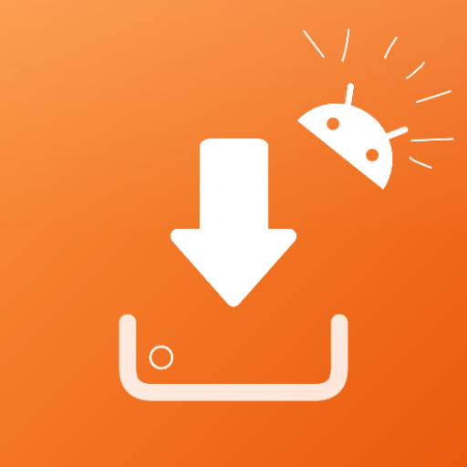
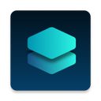
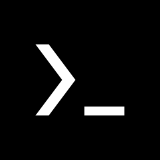
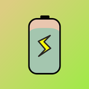
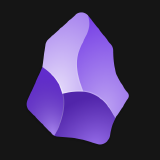
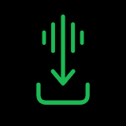
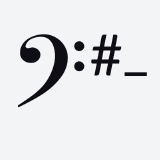

<div align="center">

<picture>
  <source media="(prefers-color-scheme: dark)" srcset="assets/banner-noche.svg">
  
</picture>

### 🐑 Pequeña colección de apps para tu Android,<br>con guía básica y para qué sirve cada una

<br>

<a href="https://kitsukilove.github.io/KixKi-Store/"></a>


<br>
<a href="https://github.com/kitsukilove/KixKi-Store/stargazers"></a>
<a href="https://github.com/kitsukilove/KixKi-Store/commits/main"></a>

<br>

[**🌐 Visitar**](https://kitsukilove.github.io/KixKi-Store/) &nbsp;·&nbsp; [**🗂️ Carpetas**](#carpetas) &nbsp;·&nbsp; [**🎒 Packs**](#packs) &nbsp;·&nbsp; [**✨ Extras**](#extras) &nbsp;·&nbsp; [**📲 Instalar**](#instalar) &nbsp;·&nbsp; [**➕ Añadir una app**](#anadir) &nbsp;·&nbsp; [**📚 Catálogo**](#catalogo)

</div>

---

## 🪟 Un escritorio pixel lleno de apps

Kixki Store es una página web (no una tienda de verdad: cada app se descarga desde su propia página) donde reúno **apps para Android** que me gustan, casi todas **open source**, y te cuento con palabras sencillas **qué hace cada una y cómo empezar a usarla**. Está hecha como un escritorio retro: cada carpeta es una ventana `.exe`, hay barra de tareas, día y noche, y una **oveja guía** llamada **Kixki** que pasea por la página. 🐑

<div align="center">

<table>
  <tr>
    <td align="center"><b>☀️ Día</b></td>
    <td align="center"><b>🌙 Noche</b></td>
  </tr>
  <tr>
    <td><a href="https://kitsukilove.github.io/KixKi-Store/"></a></td>
    <td><a href="https://kitsukilove.github.io/KixKi-Store/"></a></td>
  </tr>
</table>

<table>
  <tr>
    <td></td>
    <td></td>
  </tr>
</table>

</div>

<a id="carpetas"></a>
## 🗂️ Carpetas

**71 apps repartidas en 13 carpetas.** Ábrelas desde el escritorio (PC) o desde las filas de carpetas (móvil).

| | Carpeta | Apps | Para qué |
|:-:|---|:-:|---|
| 🧺 | **Tiendas open source** | 9 | Para encontrar, instalar y actualizar apps |
| 🔑 | **¡Importante!** | 2 | Hace que otras apps funcionen mejor |
| 🧩 | **Control de apps** | 6 | Quita, limita y revisa lo que hacen tus apps |
| 🛡️ | **Utilidad** | 5 | Automatiza, ajusta y conecta con tu PC |
| 🔋 | **Pantalla y batería** | 6 | Ahorra batería y controla tu pantalla |
| 🔒 | **Privacidad** | 10 | Protege tus datos, mensajes, llamadas y enlaces |
| 🖼️ | **Fotos y archivos** | 5 | Edita, organiza y guarda tus archivos |
| 🌐 | **Internet** | 4 | Navega, lee y comparte por la red |
| 📅 | **Día a día** | 6 | Notas, IA, reloj y entrenamientos |
| 🎮 | **Emulación** | 5 | Juega tus clásicos y optimiza tus juegos |
| 🌈 | **Decoración** | 4 | Fondos y widgets para tu pantalla |
| 🎧 | **Música** | 6 | Reproducir, descargar y crear |
| ✍️ | **Teclados** | 3 | Escribe con más estilo y más privacidad |

<a id="packs"></a>
## 🎒 Packs

¿No sabes por dónde empezar? Los **packs** son listas de apps que van bien juntas. Con un toque copias todos los enlaces de golpe.

| | Pack | Apps |
|:-:|---|---|
| 🚀 | **Para empezar** · lo mínimo para instalar y actualizar apps sin Play Store | F-Droid, Droid-ify, Aurora Store, Komi Store, Universal Installer, Shizuku |
| 🛡️ | **Privacidad** · menos rastreo y más control sobre lo que sale de tu móvil | Aurora Store, F-Droid, FireWall Blocks, PrivacyFlip, No More Background, LeanType, Exodus, Bitwarden |
| 💬 | **Mensajes privados** · cifrado de extremo a extremo, con o sin número de teléfono | Signal, Session |
| 🎨 | **Personalizar** · widgets, fondos y teclado para dejar el móvil a tu gusto | Widgets Pro, Photo Widget, GIF Live Wallpaper, Essentials, LeanType |
| 🎧 | **Música** · para escuchar y descargar tu música | Poweramp, SpotiFLAC, ClassiPod |

<a id="extras"></a>
## ✨ Qué trae la página

| Función | Qué hace |
|---|---|
| 🔍 **Buscador y etiquetas** | Busca por nombre o por lo que necesitas; filtra por *Open source*, *Compatible con Shizuku* y más. |
| ⭐ **Favoritas** | Guarda tus apps preferidas en tu propio dispositivo. |
| 🆕 **Novedades** | Las apps nuevas llevan una etiqueta «Nueva» durante unos días. |
| 🌙 **Día y noche** | Cambia de tema y de fondo: valle, primavera, verano, otoño, invierno, Halloween, Navidad o automático según la temporada. |
| 🌧️ **Ambiente** | Lluvia pixelada y sonido relajante, si quieres (se activan y desactivan a gusto). |
| 🌍 **Español · English** | Menú *Kixki → Idioma*. |
| 📱 **Móvil y PC** | Dos diseños: ventanas en ordenador, carpetas y barra inferior en móvil. |
| 🔗 **Código QR** | «Ábrelo en tu móvil»: escanea y sigue en el teléfono. |
| 🔒 **Sin terceros** | Logos, fuentes, estrellas de GitHub y el QR se guardan en la propia web: quien la visita no contacta con servidores ajenos. |
| 🐑 **Kixki, la oveja guía** | Charla, reacciona, tiene logros, minijuegos y algunos secretos escondidos. ¿Los encuentras todos? 🤫 |

<a id="instalar"></a>
## 📲 Instalar como app

Kixki Store es una **PWA**: se puede instalar y, tras la primera visita, abre rápido incluso con mala conexión.

- **Android (Chrome):** abre la web → menú **⋮** → **Instalar app** (o *Añadir a la pantalla de inicio*).
- **iPhone (Safari):** botón **Compartir** → **Añadir a pantalla de inicio**.
- **Ordenador:** el icono de instalar en la barra de direcciones de Chrome o Edge.

<a id="local"></a>
## 🧪 Probar en local

No hay nada que compilar: es HTML, CSS y JavaScript puro.

```bash
git clone https://github.com/kitsukilove/KixKi-Store.git
cd KixKi-Store
python3 -m http.server
# abre http://localhost:8000
```

<a id="anadir"></a>
## ➕ Añadir una app

Todo el catálogo vive en [`apps.json`](apps.json). Para añadir una app, copia una entrada dentro de la carpeta que quieras y cambia sus datos:

```json
{
  "name": "Mi app",
  "tag": "Qué es en pocas palabras",
  "desc": "Qué hace y cómo se usa, con palabras sencillas.",
  "links": [["Descarga", "https://…"], ["GitHub", "https://github.com/…"]],
  "tip": "Opcional: un aviso importante.",
  "added": "2026-10-21"
}
```

El logo se busca solo desde el repositorio. Al subir `apps.json`, una GitHub Action descarga logos, estrellas, fuentes y QR a la propia web.
La guía técnica completa (categorías nuevas, packs, estructura de archivos, Kixki y sus partes) está en **[docs/DESARROLLO.md](docs/DESARROLLO.md)**.

¿Falta alguna app? [Abre una sugerencia](https://github.com/kitsukilove/KixKi-Store/issues/new) y la miro. 💜

<a id="catalogo"></a>
## 📚 Catálogo completo

Abre cada carpeta para ver sus apps. Los logos y nombres pertenecen a sus creadores.

<details>
<summary><b>🧺 Tiendas open source</b> · 9 apps — <i>Para encontrar, instalar y actualizar apps</i></summary>

| | App | Para qué sirve | Enlaces |
|:-:|---|---|---|
|  | **GitHub**<br><sub>Repositorios</sub> | App oficial de GitHub: explora repositorios, lee código, sigue issues y pull requests y recibe notificaciones. | [Play](https://play.google.com/store/apps/details?id=com.github.android) |
|  | **Komi Store**<br><sub>Tienda de GitHub</sub> | Tienda gratuita y open source con los lanzamientos de GitHub, Codeberg y Forgejo para instalarlos con un toque. | [GitHub](https://github.com/komi-store/komi-store) |
|  | **F-Droid**<br><sub>Catálogo libre</sub> | Catálogo de apps libres compiladas desde su código fuente. | [Abrir](https://f-droid.org/es/) |
|  | **Droid-ify**<br><sub>Cliente de F-Droid</sub> | Cliente moderno para F-Droid y otros repositorios (como IzzyOnDroid): interfaz Material, búsqueda, instalación y avisos de actualización de apps libres. | [GitHub](https://github.com/Droid-ify/client) |
|  | **Aurora Store**<br><sub>Alternativa a Play</sub> | Cliente alternativo de Google Play: descarga apps del catálogo de Play sin iniciar sesión con tu cuenta y sin servicios de Google. | [Descarga](https://f-droid.org/packages/com.aurora.store) |
|  | **LibreFind**<br><sub>Alternativas libres</sub> | Escanea en tu móvil las apps instaladas, detecta las de código cerrado y te sugiere alternativas libres. | [Abrir](https://github-store.org/app?repo=jksalcedo/librefind) |
|  | **ShizuCoreFetch**<br><sub>Tienda con Shizuku</sub> | Tienda de apps que usa Shizuku para instalar, desinstalar y actualizar apps a nivel de sistema, sin root.<br>⚠️ <sub>Necesita Shizuku instalado y en marcha.</sub> | [GitHub](https://github.com/elhizazi1/ShizuCoreFetch) |
|  | **IzzyOnDroid**<br><sub>Cliente de repositorio</sub> | Cliente no oficial del repositorio de apps libres IzzyOnDroid: interfaz Material con tu color de acento, temas claro y oscuro, categorías, instalador de APK integrado y avisos de actualización.<br>⚠️ <sub>Ten cuidado: revisa las apps antes de instalarlas.</sub> | [Descarga](https://f-droid.org/es/packages/in.sunilpaulmathew.izzyondroid/) |
|  | **Universal Installer**<br><sub>Instalador</sub> | Instala APK, APKS, XAPK y APKM (con sus OBB). | [Abrir](https://github-store.org/app?repo=pass-with-high-score/universal-installer) |

</details>

<details>
<summary><b>🔑 ¡Importante!</b> · 2 apps — <i>Hace que otras apps funcionen mejor</i></summary>

| | App | Para qué sirve | Enlaces |
|:-:|---|---|---|
|  | **Shizuku**<br><sub>Casi como root</sub> | Permite que otras apps usen funciones del sistema que normalmente requieren root o ADB, sin rootear ni perder garantía.<br>⚠️ <sub>Ojo: su desarrollador avisó que pausó el mantenimiento por ahora.</sub> | [Descarga](https://github.com/thedjchi/Shizuku) · [Tutorial](https://youtu.be/rHDu4BQz2Fw) |
|  | **ShizukuPlus**<br><sub>Shizuku mejorado</sub> | Versión mejorada del fork de Shizuku, con otro paquete para convivir con el original.<br>⚠️ <sub>Las apps que buscan el Shizuku original pueden necesitar su modo de compatibilidad.</sub> | [GitHub](https://github.com/thejaustin/ShizukuPlus) |

</details>

<details>
<summary><b>🧩 Control de apps</b> · 6 apps — <i>Quita, limita y revisa lo que hacen tus apps</i></summary>

| | App | Para qué sirve | Enlaces |
|:-:|---|---|---|
|  | **Canta**<br><sub>Quitar bloatware</sub> | Quita o desactiva las apps del sistema que no usas (bloatware) sin root, gracias a Shizuku.<br>⚠️ <sub>Necesita Shizuku. Quitar apps del sistema puede causar fallos: consulta antes ADL y no toques las marcadas como inseguras.</sub> | [Descarga](https://f-droid.org/packages/io.github.samolego.canta) |
|  | **ADL**<br><sub>Guía anti-bloatware</sub> | Android Debloat List: wiki siempre disponible sobre las apps preinstaladas de Android.<br>⚠️ <sub>Es una web, así que necesita internet. Mírala antes de quitar nada con Canta para no dañar tu móvil.</sub> | [Abrir](https://adl.muntashir.dev/index.html) |
|  | **App Manager**<br><sub>Gestor avanzado</sub> | Gestor de apps avanzado y gratuito: ve y bloquea componentes (actividades, servicios…), detecta rastreadores y permisos, instala y exporta APK y haz copias de seguridad.<br>⚠️ <sub>Bloquear componentes puede romper apps: hazlo con cuidado.</sub> | [Descarga](https://f-droid.org/es/packages/io.github.muntashirakon.AppManager) |
|  | **App Ops**<br><sub>Permisos finos</sub> | Controla los permisos de cada app con más detalle que los ajustes normales de Android (AppOps), incluidos algunos que el sistema oculta.<br>⚠️ <sub>Necesita Shizuku. Cambiar permisos del sistema puede hacer que algunas apps fallen.</sub> | [Play](https://play.google.com/store/apps/details?id=rikka.appops) |
|  | **Inure**<br><sub>Gestor de apps</sub> | Administrador de apps muy completo: lista apps instaladas o no, deja ver y tocar sus componentes internos y trae terminal, estadísticas de uso, instalador de APK divididos…<br>⚠️ <sub>Tiene una prueba de 15 días; después se desbloquea con su versión completa.</sub> | [GitHub](https://github.com/Hamza417/Inure) |
|  | **SD Maid SE**<br><sub>Limpieza</sub> | Limpia archivos basura, restos de apps desinstaladas y duplicados, y analiza qué ocupa tu almacenamiento.<br>⚠️ <sub>Algunas funciones son de pago. Revisa bien qué vas a borrar antes de confirmar.</sub> | [Descarga](https://f-droid.org/es/packages/eu.darken.sdmse) |

</details>

<details>
<summary><b>🛡️ Utilidad</b> · 5 apps — <i>Automatiza, ajusta y conecta con tu PC</i></summary>

| | App | Para qué sirve | Enlaces |
|:-:|---|---|---|
|  | **Essentials**<br><sub>Navaja suiza</sub> | Muchas funciones en una sola app: bloqueo de apps, luz nocturna por app, control de la frecuencia de pantalla, congelar apps, automatizaciones y personalización de pantalla, como la isla flotante. | [GitHub](https://github.com/sameerasw/essentials) |
|  | **AutoPie**<br><sub>Automatizaciones</sub> | Centro de comandos y automatizaciones: ejecuta scripts de shell y Python con una interfaz sencilla, con un Termux integrado.<br>⚠️ <sub>Solo funciona en móviles arm64 (la mayoría de los recientes). Para tareas programadas, desactiva la optimización de batería de la app.</sub> | [GitHub](https://github.com/cryptrr/AutoPie) |
|  | **Termux**<br><sub>Terminal Linux</sub> | Terminal para Android con un entorno Linux: instalas paquetes con apt (Python, git, SSH, compiladores…) y trabajas desde la línea de comandos sin root.<br>⚠️ <sub>Instálalo desde F-Droid y no mezcles fuentes: sus complementos exigen la misma firma. Pide muchos permisos delicados.</sub> | [Descarga](https://f-droid.org/packages/com.termux) |
|  | **scrcpy**<br><sub>Pantalla en la PC</sub> | Muestra y controla tu Android desde la computadora por USB o Wi-Fi, sin root y sin instalar nada en el móvil.<br>⚠️ <sub>Necesita la depuración USB activada en el móvil y se usa desde la PC.</sub> | [GitHub](https://github.com/Genymobile/scrcpy) |
|  | **Plain**<br><sub>Móvil desde el navegador</sub> | Maneja tu móvil desde el navegador de otro dispositivo por la red local: archivos, fotos, vídeos, música y más, sin nube.<br>⚠️ <sub>Pide muchos permisos (archivos, contactos…): dale solo los que uses y úsala en una red de confianza.</sub> | [Descarga](https://f-droid.org/es/packages/com.ismartcoding.plain) |

</details>

<details>
<summary><b>🔋 Pantalla y batería</b> · 6 apps — <i>Ahorra batería y controla tu pantalla</i></summary>

| | App | Para qué sirve | Enlaces |
|:-:|---|---|---|
|  | **EnforceDoze**<br><sub>Ahorro de batería</sub> | Fuerza el modo Doze en cuanto se apaga la pantalla (o tras un retraso) para ahorrar batería, desactiva los sensores de movimiento y te deja gestionar la lista blanca de Doze. | [GitHub](https://github.com/Akylas/EnforceDoze) |
|  | **No More Background**<br><sub>Segundo plano</sub> | Muestra todas tus apps en una sola pantalla y eliges cuáles pueden correr en segundo plano, para cuidar batería y datos.<br>⚠️ <sub>Algunas apps pueden seguir en segundo plano aunque las apagues.</sub> | [Abrir](https://github-store.org/app?repo=adil192/no_more_background) |
|  | **BatStats**<br><sub>Estadísticas de batería</sub> | Monitor de batería con estadísticas avanzadas, como el consumo por app en mAh.<br>⚠️ <sub>Algunos datos detallados no están disponibles en todos los móviles.</sub> | [Abrir](https://github-store.org/app?repo=mlm-games/BatStats) |
|  | **Extinguish**<br><sub>Pantalla apagada</sub> | Apaga la pantalla de verdad (no pone una capa negra) y mantiene el teléfono despierto para que otras apps sigan funcionando, por ejemplo al escuchar vídeos.<br>⚠️ <sub>En móviles modificados por la marca puede no funcionar bien. Ten a mano cómo volver a encender la pantalla.</sub> | [Play](https://play.google.com/store/apps/details?id=own.moderpach.extinguish) |
|  | **Display Toggle**<br><sub>Pantalla con Shizuku</sub> | Apaga y enciende la pantalla física sin bloquear el móvil ni detener las apps abiertas.<br>⚠️ <sub>Necesita Shizuku.</sub> | [Descarga](https://f-droid.org/packages/io.github.ulysseszh.displaytoggle) |
|  | **OrientationLock**<br><sub>Orientación</sub> | Fuerza la orientación de la pantalla (vertical, horizontal, automática…) aunque una app no te deje girarla. | [GitHub](https://github.com/tuyafeng/OrientationLock) |

</details>

<details>
<summary><b>🔒 Privacidad</b> · 10 apps — <i>Protege tus datos, mensajes, llamadas y enlaces</i></summary>

| | App | Para qué sirve | Enlaces |
|:-:|---|---|---|
|  | **FireWall Blocks**<br><sub>Cortafuegos</sub> | Te deja quitar el acceso a Wi-Fi o a datos móviles app por app, para cortar conexiones que no necesitas. | [Abrir](https://github-store.org/app?repo=shynoiddev/FireWall-Blocks) |
|  | **PrivacyFlip**<br><sub>Privacidad</sub> | Al bloquear el móvil apaga Wi-Fi, Bluetooth, datos, ubicación, NFC y hasta cámara y micrófono (Android 12+); al desbloquear reactiva solo lo que elijas. | [Abrir](https://github-store.org/app?repo=dorumrr/privacyFlip) |
| 🔒 | **Alternate**<br><sub>Identificador de llamadas</sub> | Identifica quién te llama con una base de datos local, sin pasar esos números a tus contactos ni a tus apps de mensajes.<br>⚠️ <sub>Pide acceso al registro de llamadas y a mostrarse sobre otras apps. Solo arm64.</sub> | [Descarga](https://apt.izzysoft.de/fdroid/index/apk/com.lulu786.Alternate) |
|  | **Exodus**<br><sub>Detector de rastreadores</sub> | Muestra qué rastreadores y permisos lleva cada app instalada en tu móvil, usando los informes de la plataforma εxodus, de la ONG francesa Exodus Privacy. | [Descarga](https://f-droid.org/en/packages/org.eu.exodus_privacy.exodusprivacy) |
|  | **Bitwarden**<br><sub>Gestor de contraseñas</sub> | Guarda tus contraseñas y passkeys en una bóveda cifrada de extremo a extremo y las sincroniza entre tus dispositivos. | [Play](https://play.google.com/store/apps/details?id=com.x8bit.bitwarden) |
|  | **Signal**<br><sub>Mensajería privada</sub> | Mensajería privada con cifrado de extremo a extremo por defecto: chats, notas de voz, llamadas y videollamadas (grupos de hasta 1.000 personas y llamadas grupales de hasta 50).<br>⚠️ <sub>Para registrarte necesita un número de teléfono; después puedes ocultarlo a los demás con un nombre de usuario en Ajustes.</sub> | [Play](https://play.google.com/store/apps/details?id=org.thoughtcrime.securesms) · [APK](https://signal.org/android/apk/) · [GitHub](https://github.com/signalapp/Signal-Android) |
|  | **Session**<br><sub>Mensajería privada</sub> | Mensajería privada y de código abierto que no pide número de teléfono ni correo: te registras solo con un ID de cuenta.<br>⚠️ <sub>Tu cuenta se guarda con una frase de recuperación: anótala en un lugar seguro, porque sin ella no se puede recuperar.</sub> | [Abrir](https://getsession.org/) · [GitHub](https://github.com/session-foundation/session-android) |
|  | **SnapSafe**<br><sub>Cámara privada</sub> | Cámara que guarda las fotos cifradas en el almacenamiento privado de la app y no tiene permiso de internet.<br>⚠️ <sub>Las fotos viven solo dentro de la app y no entran en copias de seguridad: guarda aparte las que quieras conservar.</sub> | [Descarga](https://f-droid.org/es/packages/com.darkrockstudios.app.securecamera) |
|  | **Tarnhelm**<br><sub>Limpia enlaces</sub> | Limpia los parámetros de rastreo de los enlaces que compartes desde otras apps, de forma natural.<br>⚠️ <sub>Pide varios permisos (mostrarse sobre otras apps, inicio automático): revísalos al instalar.</sub> | [Descarga](https://f-droid.org/packages/cn.ac.lz233.tarnhelm) |
|  | **Fake Traveler**<br><sub>Ubicación falsa</sub> | Cambia tu ubicación GPS a cualquier punto del mapa.<br>⚠️ <sub>Algunas apps detectan la ubicación falsa y pueden restringir tu cuenta: úsala con cuidado.</sub> | [Descarga](https://f-droid.org/es/packages/cl.coders.faketraveler) |

</details>

<details>
<summary><b>🖼️ Fotos y archivos</b> · 5 apps — <i>Edita, organiza y guarda tus archivos</i></summary>

| | App | Para qué sirve | Enlaces |
|:-:|---|---|---|
|  | **Image Toolbox**<br><sub>Editor de imágenes</sub> | Editor de imágenes muy completo: más de 500 filtros, conversión entre formatos (JPEG, PNG, WEBP, AVIF, HEIC, JXL…), recorte, dibujo, quitar fondo, marcas de agua, collages, edición de EXIF…<br>⚠️ <sub>La versión FOSS no lleva analíticas; la de Play sí.</sub> | [GitHub](https://github.com/T8RIN/ImageToolbox) |
|  | **DeJPEG**<br><sub>Mejora de fotos</sub> | Quita artefactos de compresión, ruido y fondos de tus fotos sin conexión, con modelos ONNX que descargas una vez (FBCNN, SCUNet, RMBG).<br>⚠️ <sub>Solo funciona en arm64.</sub> | [Descarga](https://apt.izzysoft.de/fdroid/index/apk/com.je.dejpeg) |
|  | **Ente Photos**<br><sub>Fotos cifradas</sub> | Copia de seguridad y álbumes de fotos con cifrado de extremo a extremo, sincronizados entre tus dispositivos y compartibles con quien quieras.<br>⚠️ <sub>Necesita internet y una cuenta; el espacio gratis es limitado.</sub> | [Descarga](https://f-droid.org/packages/io.ente.photos.fdroid) |
|  | **TagSpaces**<br><sub>Organizador de archivos</sub> | Organiza, etiqueta y explora tus archivos, fotos y documentos sin nube ni cuentas.<br>⚠️ <sub>Pide acceso a todo el almacenamiento, porque funciona como gestor de archivos.</sub> | [Descarga](https://apt.izzysoft.de/fdroid/index/apk/org.tagspaces.mobileapp) |
|  | **Gander**<br><sub>Visor de archivos</sub> | Abre PDF, Word, Excel, PowerPoint, fotos, video, audio, Markdown, texto y código en una sola app, con búsqueda dentro de los documentos. | [Abrir](https://github-store.org/app?repo=mokshablr/gander) |

</details>

<details>
<summary><b>🌐 Internet</b> · 4 apps — <i>Navega, lee y comparte por la red</i></summary>

| | App | Para qué sirve | Enlaces |
|:-:|---|---|---|
|  | **Iceraven**<br><sub>Navegador</sub> | Navegador no oficial basado en Firefox (Fenix) con GeckoView.<br>⚠️ <sub>Sin garantías de seguridad ni de actualizaciones: sus APK usan clave de depuración, trátalo como software alfa.</sub> | [GitHub](https://github.com/fork-maintainers/iceraven-browser) |
|  | **LibreWolf**<br><sub>Navegador de PC</sub> | Navegador basado en Firefox con privacidad y seguridad reforzadas: sin telemetría y con uBlock Origin incluido.<br>⚠️ <sub>Es para computadora: no tiene versión oficial para Android.</sub> | [Abrir](https://librewolf.net/) |
|  | **RedReader**<br><sub>Alternativa a Reddit</sub> | Cliente libre y ligero para leer Reddit, sin anuncios. | [Descarga](https://f-droid.org/en/packages/org.quantumbadger.redreader) |
|  | **LocalSend**<br><sub>Enviar archivos</sub> | Envía archivos y mensajes a dispositivos cercanos por tu Wi-Fi, sin internet, cuentas ni servidores, y con cifrado.<br>⚠️ <sub>Los dispositivos deben estar en la misma red Wi-Fi.</sub> | [Abrir](https://github-store.org/app?repo=localsend/localsend) |

</details>

<details>
<summary><b>📅 Día a día</b> · 6 apps — <i>Notas, IA, reloj y entrenamientos</i></summary>

| | App | Para qué sirve | Enlaces |
|:-:|---|---|---|
|  | **Obsidian**<br><sub>Notas en Markdown</sub> | Editor de notas en Markdown que guarda todo como archivos en tu móvil y enlaza tus ideas entre sí. | [Abrir](https://github-store.org/app?repo=obsidianmd/obsidian-releases) |
| 📅 | **My Brain**<br><sub>Segundo cerebro</sub> | App de productividad con tareas (prioridad, subtareas, recordatorios), notas en Markdown, diario con estado de ánimo, marcadores… | [Descarga](https://f-droid.org/en/packages/com.mhss.app.mybrain) |
|  | **Chrono**<br><sub>Reloj y alarmas</sub> | Reloj moderno con alarmas muy configurables (días, fechas, rangos, melodía, vibración, posponer y retos como resolver cálculos o reescribir texto), relojes mundiales… | [Descarga](https://f-droid.org/packages/com.vicolo.chrono) |
|  | **LibreFit**<br><sub>Entrenamientos</sub> | Registro de entrenamientos con ejercicios, series, repeticiones y duración, gráficas de progreso, planes personalizables y más de 800 ejercicios con instrucciones e imágenes, filtrables por equipo… | [GitHub](https://github.com/LibreFitOrg/LibreFit) |
|  | **SwitchAI**<br><sub>Asistentes de IA</sub> | Elige y cambia entre más de 40 asistentes de IA (ChatGPT, Claude, Gemini, DeepSeek…) desde el gesto de asistente del sistema.<br>⚠️ <sub>Solo lanza las apps de IA que ya tengas instaladas.</sub> | [GitHub](https://github.com/WSTxda/SwitchAI) |
|  | **Euria**<br><sub>IA suiza</sub> | Asistente de IA de Infomaniak (Suiza): escribe, traduce, corrige, resume, transcribe audio, extrae texto de imágenes y busca en la web.<br>⚠️ <sub>Necesita internet y una cuenta (kSuite). Su servicio no es libre y envía informes de fallos anónimos.</sub> | [Descarga](https://f-droid.org/en/packages/com.infomaniak.euria) |

</details>

<details>
<summary><b>🎮 Emulación</b> · 5 apps — <i>Juega tus clásicos y optimiza tus juegos</i></summary>

| | App | Para qué sirve | Enlaces |
|:-:|---|---|---|
|  | **SeedlessDS**<br><sub>Nintendo DS</sub> | Emulador de Nintendo DS pensado para consolas portátiles y dispositivos de doble pantalla con botones físicos.<br>⚠️ <sub>Está en beta temprana y solo funciona en arm64. No incluye juegos ni BIOS: usa tus propias copias.</sub> | [GitHub](https://github.com/SapphireRhodonite/SeedlessDS) |
|  | **DroidDeck**<br><sub>Steam en Android</sub> | Ejecuta Steam en modo Big Picture en Android y te deja jugar juegos de Windows con Proton ARM64.<br>⚠️ <sub>Pide una GPU Adreno 730 o superior (Mali, Xclipse y PowerVR no funcionan) y unos 3 GB libres.</sub> | [Abrir](https://github-store.org/app?repo=Droid-Deck/DroidDeck) |
|  | **Lemuroid**<br><sub>Retro todo en uno</sub> | Emulador libre basado en Libretro que cubre NES, SNES, Game Boy, Genesis, N64, PlayStation, PSP, Nintendo DS y muchos sistemas más.<br>⚠️ <sub>No incluye juegos: añade tus propias ROMs.</sub> | [Abrir](https://github-store.org/app?repo=Swordfish90/Lemuroid) |
|  | **Kimu X64**<br><sub>Buscar juegos</sub> | Página para buscar juegos para tus emuladores, hecha por Kimu X64, creador de contenido en YouTube que también habla de privacidad, Linux en equipos viejos y modding de consolas. | [Abrir](https://notkimu.github.io/kimu64/) · [Créditos](https://youtube.com/@kimu_x64) |
|  | **CatSmoker**<br><sub>Optimizador de juegos</sub> | Optimiza juegos compatibles: simula otros modelos de móvil para desbloquear más gráficos y FPS, cambia resolución y DPI, edita archivos de configuración del juego, muestra FPS, CPU…<br>⚠️ <sub>Modificar archivos o falsear el dispositivo puede romper las reglas de algunos juegos y causar baneos. El riesgo es tuyo.</sub> | [GitHub](https://github.com/catsmoker/com.catsmoker.app) |

</details>

<details>
<summary><b>🌈 Decoración</b> · 4 apps — <i>Fondos y widgets para tu pantalla</i></summary>

| | App | Para qué sirve | Enlaces |
|:-:|---|---|---|
|  | **GIF Live Wallpaper**<br><sub>Fondo animado</sub> | Usa un GIF como fondo de pantalla animado. | [Descarga](https://f-droid.org/packages/net.redwarp.gifwallpaper) |
|  | **Widgets Pro**<br><sub>Widgets</sub> | Colección de widgets con estilo Nothing OS (Android 12+): reproductor de música que funciona con la mayoría de reproductores, seguimiento del sol, widget de deportes y, con Shizuku…<br>⚠️ <sub>Si los widgets no se actualizan, desactiva la optimización de batería para la app.</sub> | [Abrir](https://github-store.org/app?repo=preethamkmr3/WidgetsPro) |
|  | **Photo Widget**<br><sub>Widgets de fotos</sub> | Convierte imágenes de tu galería en widgets, con bastante personalización de estilo. | [Abrir](https://github-store.org/app?repo=fibelatti/photo-widget) |
|  | **L.L.E**<br><sub>Efectos de bloqueo</sub> | Trae a móviles modernos los efectos clásicos de la pantalla de bloqueo (Legacy Lockscreen Effects): destello de lente, ondas de agua, acuarela, mosaicos, gotas de colores y burbujas brillantes.<br>⚠️ <sub>Está en beta, puede fallar. Usa el APK de 32 bits si tu móvil lo soporta.</sub> | [GitHub](https://github.com/Brazzo978/L.L.E-Legacy-Lockscreen-Effects) |

</details>

<details>
<summary><b>🎧 Música</b> · 6 apps — <i>Reproducir, descargar y crear</i></summary>

| | App | Para qué sirve | Enlaces |
|:-:|---|---|---|
|  | **Poweramp**<br><sub>Reproductor</sub> | Reproductor excelente, con ecualizador avanzado y widgets de música variados y muy personalizables. | [Play](https://play.google.com/store/apps/details?id=com.maxmpz.audioplayer) |
|  | **SpotiFLAC**<br><sub>Descargas</sub> | Open source, sin anuncios ni suscripción.<br>⚠️ <sub>Primero: en la pestaña Tienda pega el enlace de «Extensión» y luego instala las extensiones con un toque. Si una canción no se encuentra, activa más proveedores en Ajustes > Extensiones. Úsala solo con contenido que puedas descargar legalmente.</sub> | [Abrir](https://github.com/spotiflacapp/SpotiFLAC-Mobile) · [Extensión](https://raw.githubusercontent.com/zarzet/SpotiFLAC-Extension/main/registry.json) |
|  | **WEcho**<br><sub>Efectos de audio</sub> | Aplica efectos de audio a todo el sonido del sistema, no solo a un reproductor: ecualizador de 1 a 64 bandas, compresor, refuerzo de graves, reverb…<br>⚠️ <sub>Solo arm64. El agente de IA «Echo» necesita tu propia clave de un modelo de lenguaje.</sub> | [GitHub](https://github.com/qumolangmo/wecho) |
|  | **ClassiPod**<br><sub>Reproductor retro</sub> | Reproductor de la música guardada en tu móvil con el diseño del iPod Classic. | [Descarga](https://f-droid.org/en/packages/com.adeeteya.classipod) |
|  | **Helio**<br><sub>Crear música</sub> | Secuenciador musical libre para componer: editor por patrones, instrumentos SoundFont, escalas exóticas y control de versiones para sincronizar tus proyectos entre dispositivos.<br>⚠️ <sub>Sirve para crear música, no para reproducirla.</sub> | [Descarga](https://f-droid.org/es/packages/fm.helio) |
|  | **Ambient Music Mod**<br><sub>Ahora suena</sub> | Lleva «Ahora suena» de los Pixel a otros Android: reconoce la música de fondo con una base de datos local, con historial, favoritos, widget y reconocimiento manual.<br>⚠️ <sub>Con Shizuku hay que volver a iniciarlo tras cada reinicio. Para mostrar la canción en el bloqueo pide un servicio de accesibilidad.</sub> | [GitHub](https://github.com/KieronQuinn/AmbientMusicMod) |

</details>

<details>
<summary><b>✍️ Teclados</b> · 3 apps — <i>Escribe con más estilo y más privacidad</i></summary>

| | App | Para qué sirve | Enlaces |
|:-:|---|---|---|
|  | **LeanType**<br><sub>Reemplazo de Gboard</sub> | Teclado open source basado en HeliBoard: temas y distribuciones personalizables, teclado flotante, modo a una mano y portapapeles con historial. | [Abrir](https://github-store.org/app?repo=LeanBitLab/LeanType) |
|  | **Irregular Expressions**<br><sub>Fuentes de texto</sub> | Teclado muy básico, pero ofrece distintas fuentes de texto para escribir con estilo, algo que normalmente dan apps de Play Store con rastreadores. | [Abrir](https://github-store.org/app?repo=MobileFirstLLC/irregular-expressions) |
|  | **GifBoard**<br><sub>Buscador de GIFs</sub> | Busca y comparte GIFs desde el teclado sin salir de la app.<br>⚠️ <sub>Ojo: usa la búsqueda de imágenes de Google, así que depende de ese servicio.</sub> | [Abrir](https://github-store.org/app?repo=gifboard/gifboard) |

</details>

---

## ⚠️ Antes de instalar

- **Revisa cada app antes de instalarla**, sobre todo si viene de una tienda de terceros (por ejemplo IzzyOnDroid).
- Kixki Store **no es la autora ni la dueña** de ninguna de estas apps: solo las recopila y explica. Los nombres, logos y marcas son de sus respectivos creadores.
- Algunas apps necesitan **Shizuku** y quitar apps del sistema puede causar fallos. Lee el aviso ⚠️ de cada ficha.

## 🙏 Créditos

- Hecho con 💜 por **[KitsukiLove](https://github.com/kitsukilove)**.
- Fuentes: [Pixelify Sans](https://fonts.google.com/specimen/Pixelify+Sans) y [Jersey 10](https://fonts.google.com/specimen/Jersey+10) (SIL Open Font License).
- Códigos QR: [qrcode-generator](https://github.com/kazuhikoarase/qrcode-generator) de Kazuhiko Arase.
- Gracias a todas las personas que crean y mantienen las apps de esta lista. 🐑

<div align="center">
<br>

<picture>
  <source media="(prefers-color-scheme: dark)" srcset="assets/banner-noche.svg">
  
</picture>

<sub>Kixki Store · Hecho con ♥ por KitsukiLove</sub>

</div>
